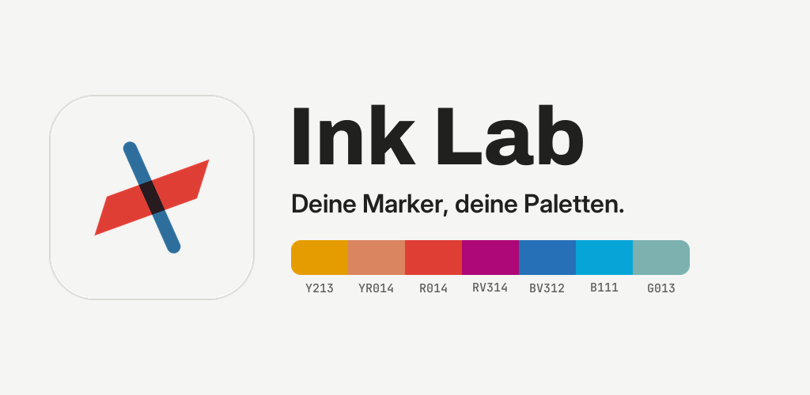
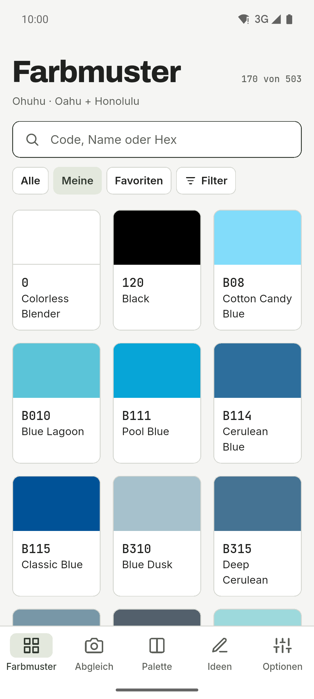
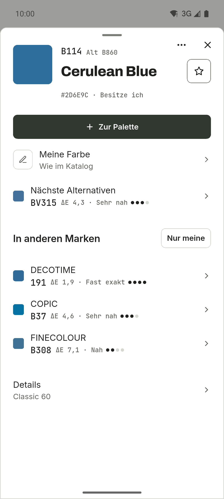
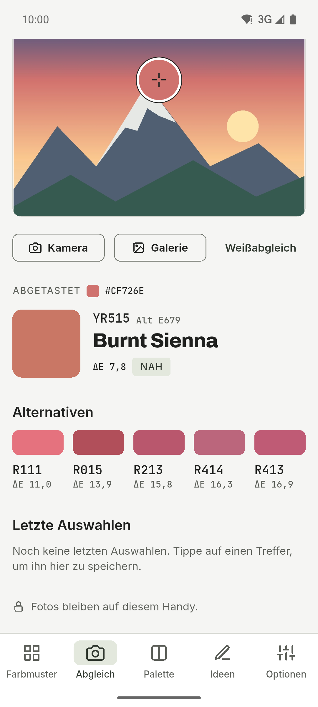
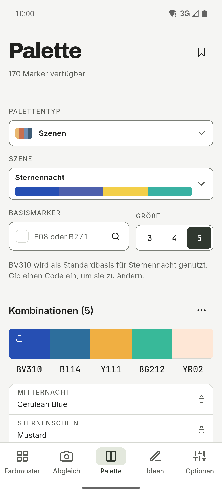
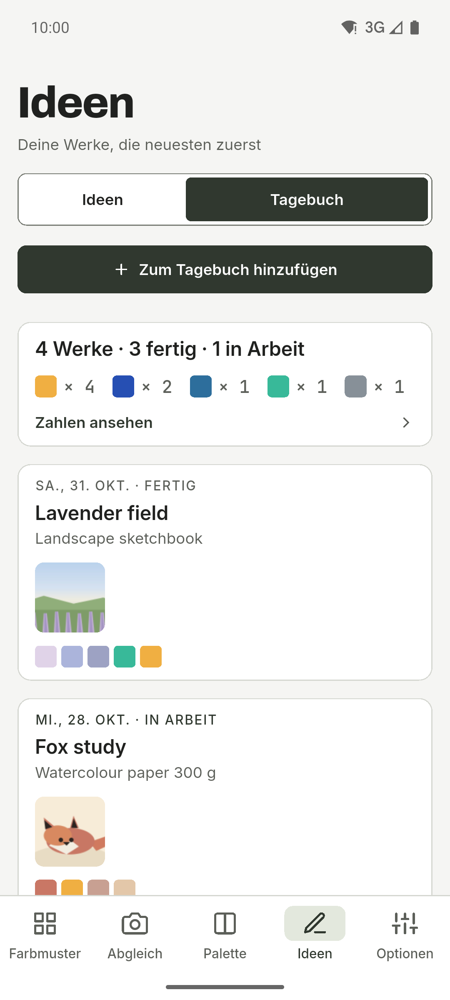
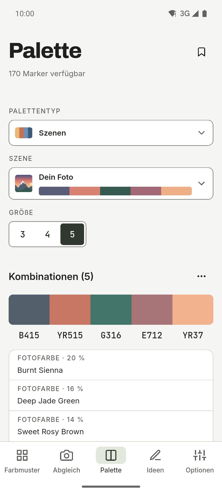
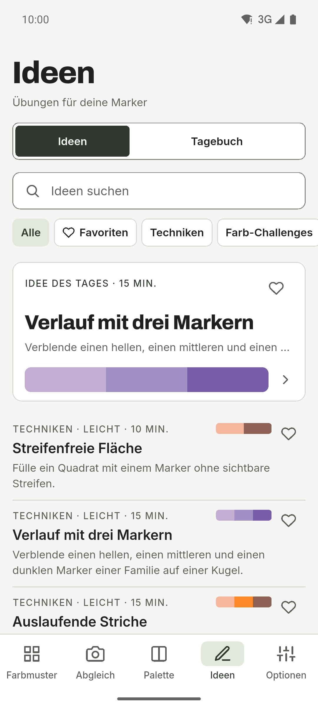
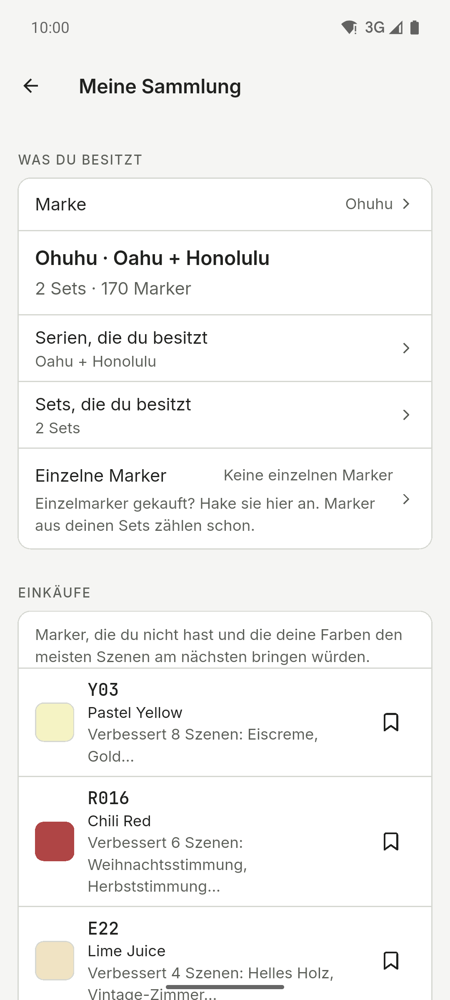
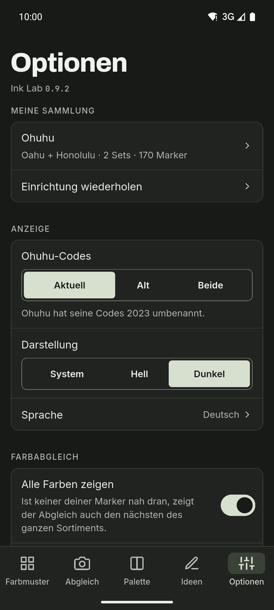

[English](README.md) · [Español](README.es.md) · **Deutsch** · [Français](README.fr.md) · [Português](README.pt.md) · [Italiano](README.it.md)

  

# Ink Lab

Begleiter für Farbmuster und Paletten für alle, die mit Alkoholmarkern zeichnen.
Schlage den Code einer Farbe nach, finde heraus, welcher Marker deiner Sammlung
einem Foto am nächsten kommt, und erstelle Paletten nach der Farbtheorie – nur
mit den Markern, die du besitzt. Android-App mit hellem und dunklem Design,
Seitenleiste auf Tablets und sechs Sprachen.

**Kostenlos · Keine Werbung · Kein Konto · Offline · Open Source**

Die KI ist optional und standardmäßig aus.

## Downloads

  
  
  <!--
  
  -->

Android auf GitHub und in geschlossener Testphase bei Google Play. iOS kommt später.

Der Google-Play-Beta beitreten

1. Tritt der Gruppe [ink-lab-testers](https://groups.google.com/g/ink-lab-testers) bei. Melde dich bei Google an und drücke „Gruppe beitreten“.
2. Bestätige deine Teilnahme am Test: [play.google.com/apps/testing/es.inklab.app](https://play.google.com/apps/testing/es.inklab.app).
3. Installiere die App aus Google Play. Sie aktualisiert sich selbst.

Bleib 14 Tage dabei: Google verlangt 12 Tester über 14 Tage vor der
Veröffentlichung. Feedback: inklab@mainshai.com.

Die APK von GitHub installieren

1. Lade die APK und `SHA256SUMS.txt` der [letzten
   Version](https://github.com/dferrandizmont/ink-lab/releases/latest) herunter. Prüfe sie mit
   `sha256sum -c SHA256SUMS.txt`.
2. Erlaube die Installation aus unbekannten Quellen, wenn das Handy danach
   fragt, und öffne die APK.

## Screenshots

  
  
  
  
  

Mehr Screenshots

  
  
  
  

Tippe auf einen Screenshot, um ihn zu vergrößern.

## Funktionen

- **Tagebuch.** Ein Protokoll deiner Werke, mit Fotos, den benutzten Markern und
  den Zahlen dahinter.
- **Vier Marken.** Ohuhu (503 Farben), DecoTime (313), Copic (358) und Finecolour
  (480), mit dem ähnlichsten Marker jeder anderen Marke unter „In anderen Marken“.
- **Abgleich.** Tippe auf einen Punkt in einem Foto, um den ähnlichsten Marker
  deiner Sammlung zu finden, und korrigiere den Weißabgleich.
- **Paletten und Szenen.** Farbharmonien, Blend-Ketten und 67 fertige Szenen in
  11 Kategorien.
- **Sicherung.** Speichere alles in einer `.zip`-Datei, mit den Tagebuchfotos
  darin.
- **Einkäufe.** Eine Wunschliste, ausgetrocknete Marker und was als Nächstes
  kaufen.

Weitere Funktionen

- **Farbsehen.** Sieh dir eine Palette an, wie sie jemand mit Protanopie,
  Deuteranopie, Tritanopie oder Achromatopsie sieht.
- **Druckbare Farbkarte.** A4-Seiten mit einer beschrifteten Box für jeden
  Marker, den du besitzt.
- **Ideen.** Übungen und Techniken mit eigenen Paletten, und deine Favoriten.
- **Farbmuster und deine eigene Farbe.** Codes, Namen und Hex-Werte, dazu die
  Farbe, die dein Marker wirklich ergibt.
- **Teilen.** Schicke eine Palette, eine Farbkarte oder einen Tagebucheintrag
  als Bild an eine andere App.
- **KI, wenn du willst.** Optionale Palettenvorschläge: Gemini Nano auf dem
  Handy oder OpenRouter mit deinem eigenen Schlüssel.

## Datenschutz

Deine Daten bleiben auf dem Handy: kein Konto, kein eigener Server, keine
Analyse, keine Werbung und kein Tracking; ohne KI wird die Netzverbindung nie
genutzt. ML Kit der On-Device-KI sendet Google Nutzungsdiagnosen, nie Anfragen,
Farben oder Fotos. Kamera- und Galerie-Zugriff gibt es nur für den Fotoabgleich,
Szenen, deine eigenen Markerfarben und das Tagebuch; diese Fotos werden auf dem
Gerät verarbeitet, und die Tagebuchfotos bleiben im privaten Ordner der App und
werden nie hochgeladen. Beim Teilen einer Palette, einer Farbkarte oder der
`.zip`-Sicherung geht die Datei nur an die App, die du auswählst, und an nichts
weiter.

[Website](https://inklab.mainshai.com/de/) · [Datenschutzerklärung](https://inklab.mainshai.com/de/privacy/) ·
[Technische Details](docs/privacy.en.md) · Support: **inklab@mainshai.com**.

## Neuerungen

Version 0.9.2 ist da. Die 0.9-Reihe hat die App aufgeräumt: ein ruhigeres Blatt
für den Marker, ordentlichere Bildschirme und Korrekturen für große Systemschrift.
Die vollständige Liste steht in [CHANGELOG.md](CHANGELOG.md) und in den
[Releases](https://github.com/dferrandizmont/ink-lab/releases).

## Mitwirken

Fehlermeldungen, Ideen und Übersetzungen sind willkommen. Wie man baut, testet und
beiträgt: [CONTRIBUTING.md](CONTRIBUTING.md).

## Lizenz

Code unter [MIT](LICENSE), Copyright (c) 2026 Daniel Mont Ferrandiz. Eigene
Dokumentation und Texte: [CC BY-SA 4.0](LICENSE-CONTENT.md). Die Katalogdaten
sind faktische Referenzen von Drittanbietern und fallen unter keine der beiden
Lizenzen; die Schriften (SIL OFL 1.1) und anderes Material von Drittanbietern
behalten ihre eigenen Bedingungen.

Ein unabhängiges Projekt: **weder mit Ohuhu, DecoTime, Copic oder Finecolour verbunden noch
von einer dieser Marken gesponsert oder unterstützt**. „Ohuhu“, „Oahu“, „DecoTime“, „Copic“ und „Finecolour“ sind Marken ihrer Inhaber.
Vollständige Hinweise: [NOTICE.md](NOTICE.md).

Sicherheitslücken melden: [SECURITY.md](SECURITY.md).
