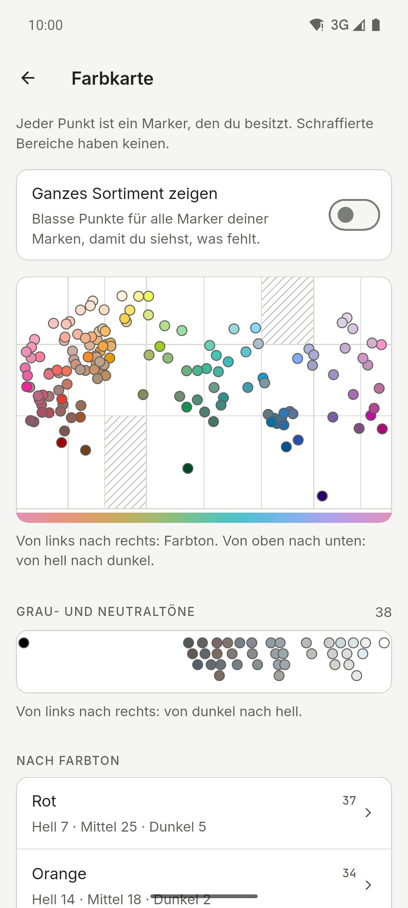

[English](README.md) · [Español](README.es.md) · **Deutsch** · [Français](README.fr.md) · [Português](README.pt.md) · [Italiano](README.it.md)

  

# Ink Lab

Begleiter für Farbmuster und Paletten für alle, die mit Alkoholmarkern zeichnen. Schlage
den Code einer Farbe nach, finde heraus, welcher Marker deiner Sammlung einem Foto am
nächsten kommt, und erstelle Paletten nach der Farbtheorie – nur mit den Markern, die du
besitzt. App für Android, iPhone und iPad mit hellem und dunklem Design, Tablet-Layouts
und sechs Sprachen.

**Kostenlos · Keine Werbung · Kein Konto · Offline · Open Source**

Die KI ist optional und standardmäßig aus.

## Downloads

  
  
  

iPhone und iPad im App Store. Android auf GitHub und in geschlossener Testphase bei Google Play.

Der Google-Play-Beta beitreten

1. Tritt der Gruppe [ink-lab-testers](https://groups.google.com/g/ink-lab-testers) bei. Melde dich bei Google an und drücke „Gruppe beitreten“.
2. Bestätige deine Teilnahme am Test: [play.google.com/apps/testing/es.inklab.app](https://play.google.com/apps/testing/es.inklab.app).
3. Installiere die App aus Google Play. Sie aktualisiert sich selbst.

Bleib 14 Tage dabei: Google verlangt 12 Tester über 14 Tage vor der
Veröffentlichung. Feedback: inklab@mainshai.com.

Die APK von GitHub installieren

1. Lade die APK und `SHA256SUMS.txt` der [letzten
   Version](https://github.com/dferrandizmont/ink-lab/releases/latest) herunter. Prüfe sie mit
   `sha256sum -c SHA256SUMS.txt`.
2. Erlaube die Installation aus unbekannten Quellen, wenn das Handy danach
   fragt, und öffne die APK.

## Screenshots

  
  
  
  
  

Mehr Screenshots

  
  
  
  
  

Tippe auf einen Screenshot, um ihn zu vergrößern.

## Funktionen

- **Fünfzehn Marken, 3.420 Farben.** Ohuhu, DecoTime, Copic (Sketch, Ciao und Classic),
  Finecolour, Touch Twin, Promarker, Promarker Brush, Prismacolor Premier, Spectrum
  Noir, Arrtx, ZIG Kurecolor, Graph'it, Marvy Le Plume, Blick Studio Brush und Artist's
  Loft, mit Markensuche und «In anderen Marken».
- **Marker-Details.** Tintenstand und Nachfüll-Notiz, ein Foto deiner echten Farbprobe,
  Schatten und Licht, „Mischen mit …“ und ein Hinweis auf fast gleiche Marker.
- **Abgleich.** Tippe auf einen Punkt in einem Foto, um den ähnlichsten Marker deiner
  Sammlung zu finden, korrigiere den Weißabgleich und prüfe die Tonwerte in Grau.
- **Paletten und Szenen.** Farbharmonien, Blend-Ketten und 67 fertige Szenen, mit
  Staffelei-Modus und Paletten, die du als Text teilst oder importierst.
- **Werkzeuge.** Eine Farbkarte deiner Sammlung, ein Übersetzer für Rezepte anderer
  Marken, eigene Mischrezepte mit Foto sowie Export und Import als CSV oder Text.
- **Tagebuch.** Ein Protokoll deiner Werke, mit Fotos, den benutzten Markern und den
  Zahlen dahinter.
- **Sicherung.** Speichere alles in einer `.zip`-Datei, Fotos inklusive; die Optionen
  zeigen das Datum der letzten.

Weitere Funktionen

- **Einkäufe.** Eine Wunschliste, ausgetrocknete Marker und was als Nächstes kaufen.
- **Farbsehen.** Sieh eine Palette so, wie sie jemand mit Farbfehlsichtigkeit sieht.
- **Druckbare Farbkarte.** A4-Seiten mit einer beschrifteten Box für jeden Marker, den
  du besitzt.
- **Ideen.** Übungen und Techniken mit eigenen Paletten, und deine Favoriten.
- **Farbmuster und deine eigene Farbe.** Codes, Namen und Hex-Werte (ein Hex-Wert findet
  die nächsten Marker), dazu die Farbe, die dein Marker wirklich ergibt.
- **KI, wenn du willst.** Optionale Palettenvorschläge: Gemini Nano auf dem Handy oder
  OpenRouter mit deinem eigenen Schlüssel.
- **Widget „Idee des Tages“.** Nur unter Android: die heutige Übung in den Farben deiner
  Marker, auf dem Startbildschirm.
- **Verknüpfungen.** Vom App-Symbol direkt zum Abgleich, zu einer neuen Palette oder zur
  Farbmustersuche.
- **Optionen.** Open-Source-Lizenzen, „Feedback senden“ und ein lokales Fehlerprotokoll,
  das du teilen oder löschen kannst.

## Datenschutz

Deine Daten bleiben auf dem Handy: kein Konto, kein eigener Server, keine Analyse, keine
Werbung und kein Tracking; ohne KI wird die Netzverbindung nie genutzt. ML Kit der
On-Device-KI sendet Google Nutzungsdiagnosen, nie Anfragen, Farben oder Fotos. Kamera-
und Galerie-Zugriff gibt es nur für den Fotoabgleich, Szenen, deine eigenen
Markerfarben, das Tagebuch, echte Farbproben und Mischrezepte; diese Fotos werden auf
dem Gerät verarbeitet, und die gespeicherten bleiben im privaten Ordner der App und
werden nie hochgeladen. Beim Teilen einer Palette, einer Farbkarte oder der
`.zip`-Sicherung geht die Datei nur an die App, die du auswählst, und an nichts weiter.

[Website](https://inklab.mainshai.com/de/) · [Datenschutzerklärung](https://inklab.mainshai.com/de/privacy/) ·
[Technische Details](docs/privacy.en.md) · Support: **inklab@mainshai.com**.

## Neuerungen

Version 1.2.5 behält eine Palette einer Marke, die du nicht nutzt, beim Neu erstellen, zeigt Marke und Code bei gemischten Marken und großer Schrift vollständig und zeigt pro Variante nur einen Hinweis. Version 1.2.4 behält die Palette beim Wechsel der Marke auf dem Bildschirm, und macht Palette auf Tablets klarer. Version 1.2.3 behält deine Marker, wo sie sind: Eine Farbe zu sperren bewegt sie nicht mehr, eine Familie hinzuzufügen löscht die importierten Marker nicht mehr, und ohne markierte Marker sagt die App das, statt das ganze Sortiment zu nehmen; du kannst auch alle Marken mischen. Version 1.2.2 behebt, was eine Prüfung aller Bildschirme gefunden hat: Gespeicherte Paletten öffnen sich mit einem Tipp, Zurück unter Android führt zu Farbmuster, und die Texte sind klarer. Version 1.2.1 zeigt Ideenbeschreibungen vollständig und behebt kleine Anzeigefehler. Version 1.2.0 brachte 100 Ideen statt 28, nach Schwierigkeit und Jahreszeit geordnet, damit du sie leicht
findest, und ein aufgeräumteres Seitenmenü auf Tablets. Die vollständige Liste steht in
[CHANGELOG.md](CHANGELOG.md) und in den
[Releases](https://github.com/dferrandizmont/ink-lab/releases).

## Mitwirken

Fehlermeldungen, Ideen und Übersetzungen sind willkommen. Wie man baut, testet und
beiträgt: [CONTRIBUTING.md](CONTRIBUTING.md).

## Lizenz

Code unter [MIT](LICENSE), Copyright (c) 2026 Daniel Mont Ferrandiz. Eigene
Dokumentation und Texte: [CC BY-SA 4.0](LICENSE-CONTENT.md). Die Katalogdaten
sind faktische Referenzen von Drittanbietern und fallen unter keine der beiden
Lizenzen; die Schriften (SIL OFL 1.1) und anderes Material von Drittanbietern
behalten ihre eigenen Bedingungen.

Ein unabhängiges Projekt: **mit keiner dieser Markermarken verbunden und von
keiner gesponsert oder unterstützt**. Die Namen der oben genannten Marken sind Marken ihrer jeweiligen Inhaber.
Vollständige Hinweise: [NOTICE.md](NOTICE.md).

Sicherheitslücken melden: [SECURITY.md](SECURITY.md).
