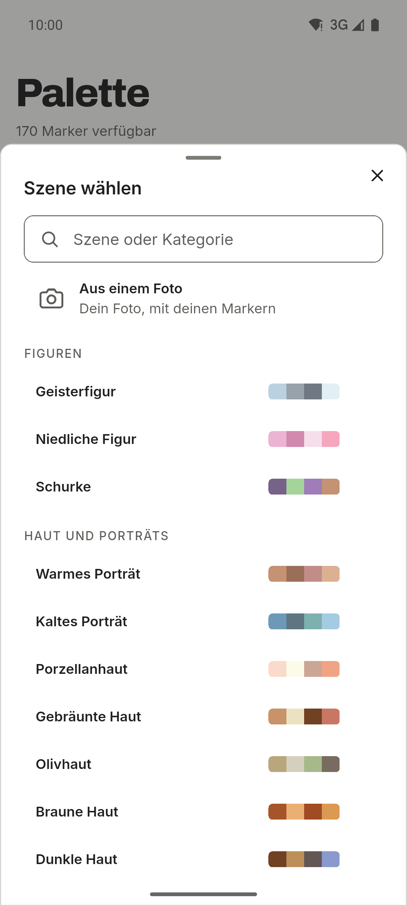
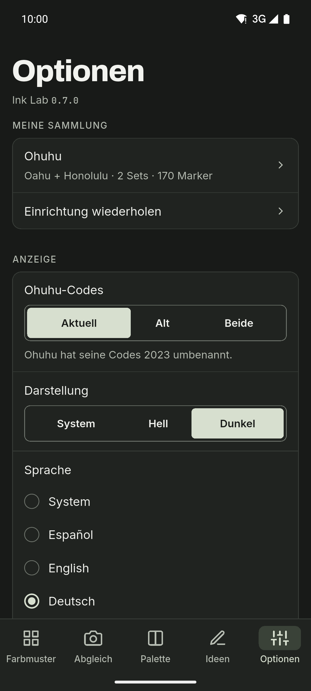

[English](README.md) · [Español](README.es.md) · **Deutsch** · [Français](README.fr.md) · [Português](README.pt.md) · [Italiano](README.it.md)

  

# Ink Lab

Begleiter für Farbmuster und Paletten für alle, die mit Alkoholmarkern zeichnen.
Schlage den Code einer Farbe nach, finde heraus, welcher Marker deiner Sammlung
einem Foto am nächsten kommt, und erstelle Paletten nach der Farbtheorie – nur
mit den Markern, die du besitzt. Android-App mit hellem und dunklem Design,
Seitenleiste auf Tablets und sechs Sprachen.

**Kostenlos · Keine Werbung · Kein Konto · Offline · Open Source**

Die KI ist optional und standardmäßig aus.

## Downloads

  
  
  <!--
  
  -->

Android auf GitHub und in geschlossener Testphase bei Google Play. iOS kommt später.

Der Google-Play-Beta beitreten

Jeder kann am geschlossenen Test teilnehmen:

1. Tritt der Gruppe [ink-lab-testers](https://groups.google.com/g/ink-lab-testers) bei. Melde dich bei Google an und drücke „Gruppe beitreten“.
2. Bestätige deine Teilnahme am Test: [play.google.com/apps/testing/es.inklab.app](https://play.google.com/apps/testing/es.inklab.app).
3. Installiere die App aus Google Play. Sie aktualisiert sich selbst.

Bleib 14 Tage dabei: Google verlangt 12 Tester über 14 Tage vor der
Veröffentlichung. Feedback: inklab@mainshai.com.

Die APK von GitHub installieren

1. Lade die APK und `SHA256SUMS.txt` der [letzten
   Version](https://github.com/dferrandizmont/ink-lab/releases/latest) herunter. Prüfe sie mit
   `sha256sum -c SHA256SUMS.txt`.
2. Erlaube die Installation aus unbekannten Quellen, wenn das Handy danach
   fragt, und öffne die APK.

## Screenshots

  
  
  
  
  

Mehr Screenshots

  
  
  

Tippe auf einen Screenshot, um ihn zu vergrößern.

## Funktionen

- **Meine Marker.** Eine Einführung baut die Sammlung jeder Marke aus deinen
  Serien, Sets und einzelnen Markern auf.
- **Abgleich mit einem Foto.** Tippe auf einen Punkt, um den farblich ähnlichsten
  Marker aus deiner Sammlung zu finden; korrigiere den Weißabgleich, damit die
  aufgenommenen Farben stimmen.
- **Deine eigene Farbe.** Die Katalogfarbe ist eine Schätzung; lege die Farbe
  fest, die dein Marker wirklich ergibt, per Hex oder Foto.
- **Paletten und Blend-Ketten.** Farbharmonien und Blend-Ketten aus drei bis fünf
  Markern, vom hellsten zum dunkelsten.
- **Szenen.** 67 Rezepte in 11 Kategorien, jedes mit seinen Farbrollen.
- **Tagebuch.** Ein Protokoll deiner Werke: Datum, Papier, Marker, Notizen
  und bis zu vier Fotos.
- **Drei Marken.** Ohuhu (503 Farben), DecoTime (313) und Copic (358), jeweils
  mit einzelner Markerauswahl.

Weitere Funktionen

- **Farbmuster.** Codes, Namen und Hex-Werte, mit Suche, Filtern und Favoriten.
- **Szene aus einem Foto.** Ordne die Hauptfarben eines Fotos den farblich
  ähnlichsten Markern aus deiner Sammlung zu.
- **Teilen und drucken.** Teile eine Palette als Bild oder erstelle eine
  druckbare A4-Farbkarte.
- **Wunschliste und ausgetrocknete Marker.** Merke dir die Marker, die du kaufen
  willst, und markiere verbrauchte als ausgetrocknet, damit die App sie
  überspringt.
- **Ideen und KI.** Challenges und Techniken, dazu optional Gemini Nano auf
  kompatiblen Android-Geräten oder OpenRouter mit deinem eigenen API-Schlüssel.
- **Sicherung.** Exportiere und importiere deine Daten als JSON-Text, ohne Fotos.

## Datenschutz

Deine Daten bleiben auf dem Handy: kein Konto, kein eigener Server, keine eigene
Nutzungsanalyse, keine Werbung und kein Tracking; ohne KI wird die
Netzverbindung nie genutzt. ML Kit der On-Device-KI sendet Google
Nutzungsdiagnosen, nie Anfragen, Farben oder Fotos. Kamera- und Galerie-Zugriff
gibt es nur für den Fotoabgleich, Szenen, deine eigenen Markerfarben und das
Tagebuch; die Fotos für Abgleich und Szenen werden auf dem Gerät verarbeitet, und
Tagebuchfotos bleiben im privaten Ordner der App und werden nie hochgeladen.
Beim Teilen einer Palette oder einer Farbkarte geht das Bild nur an die App, die
du auswählst.

[Website](https://inklab.mainshai.com/de/) · [Datenschutzerklärung](https://inklab.mainshai.com/de/privacy/) ·
[Technische Details](docs/privacy.en.md) · Support: **inklab@mainshai.com**.

## Neuerungen

0.7.0 bringt das Tagebuch, Blend-Ketten, deine eigenen Farben mit der
Weißabgleich-Korrektur, die Wunschliste, ausgetrocknete Marker, druckbare
Farbkarten und das Teilen. Die vollständige Liste steht in [CHANGELOG.md](CHANGELOG.md).

## Mitwirken

Fehlermeldungen, Ideen und Übersetzungen sind willkommen. Wie man baut, testet und
beiträgt: [CONTRIBUTING.md](CONTRIBUTING.md).

## Lizenz

Code unter [MIT](LICENSE), Copyright (c) 2026 Daniel Mont Ferrandiz. Eigene
Dokumentation und Texte: [CC BY-SA 4.0](LICENSE-CONTENT.md). Die Katalogdaten
sind faktische Referenzen von Drittanbietern und fallen unter keine der beiden
Lizenzen; die Schriften (SIL OFL 1.1) und anderes Material von Drittanbietern
behalten ihre eigenen Bedingungen, aufgeführt in [NOTICE.md](NOTICE.md).

Ein unabhängiges Projekt: **weder mit Ohuhu, DecoTime oder Copic verbunden noch
von einer dieser Marken gesponsert oder unterstützt**. „Ohuhu“, „Oahu“, „DecoTime“ und „Copic“ sind Marken ihrer Inhaber.
Quellen und vollständige Hinweise stehen in [NOTICE.md](NOTICE.md).

Sicherheitslücken melden: [SECURITY.md](SECURITY.md).
