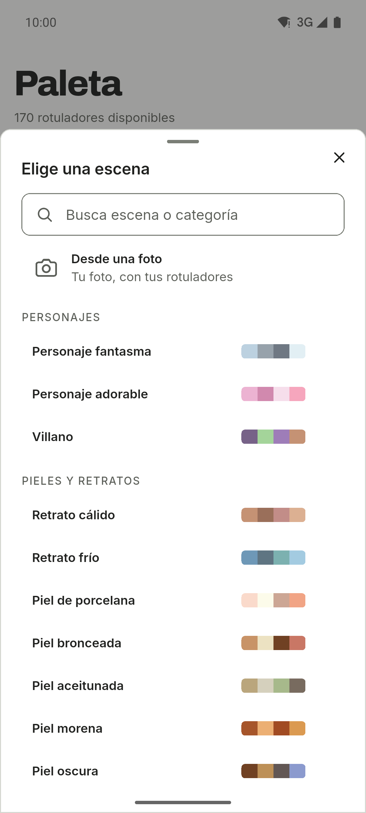
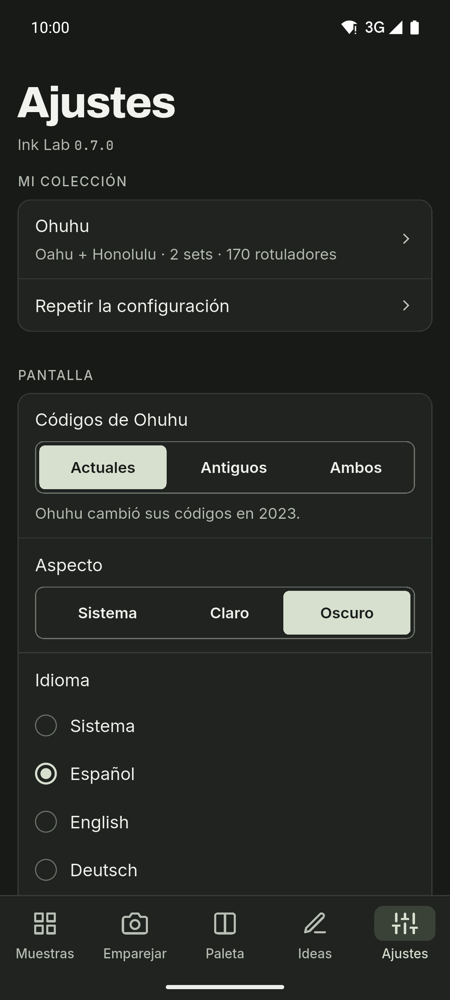

[English](README.md) · **Español** · [Deutsch](README.de.md) · [Français](README.fr.md) · [Português](README.pt.md) · [Italiano](README.it.md)

  

# Ink Lab

Compañero de muestras y paletas para quien dibuja con rotuladores de alcohol.
Busca el código de un color, descubre qué rotulador tuyo se parece más a una foto
y crea paletas con teoría del color usando solo tus rotuladores. App para Android,
con modo claro y oscuro, raíl lateral en tablets y seis idiomas.

**Gratis · Sin anuncios · Sin cuenta · Sin conexión · Código abierto**

La IA es opcional y está apagada de serie.

## Descargas

  
  
  <!--
  
  -->

Android en GitHub y en prueba cerrada en Google Play. iOS, más adelante.

Únete a la beta de Google Play

Cualquiera puede apuntarse a la prueba cerrada:

1. Únete al grupo de testers: [ink-lab-testers](https://groups.google.com/g/ink-lab-testers). Con tu cuenta de Google, pulsa «Unirse al grupo».
2. Acepta la prueba: [play.google.com/apps/testing/es.inklab.app](https://play.google.com/apps/testing/es.inklab.app).
3. Instala la app desde Google Play. Se actualizará sola.

Quédate 14 días: Google exige 12 testers durante 14 días antes de publicarla.
Comentarios: inklab@mainshai.com.

Instala el APK desde GitHub

1. Descarga el APK y `SHA256SUMS.txt` de la [última
   versión](https://github.com/dferrandizmont/ink-lab/releases/latest). Comprueba la descarga con
   `sha256sum -c SHA256SUMS.txt`.
2. Permite «instalar aplicaciones de origen desconocido» cuando el móvil lo
   pida y abre el APK.

## Capturas

  
  
  
  
  

Más capturas

  
  
  

Pulsa una captura para ampliarla.

## Funciones

- **Mis rotuladores.** Una guía inicial prepara la colección de cada marca con tus
  series, sets y rotuladores sueltos.
- **Emparejar con una foto.** Toca un punto para encontrar tu rotulador más
  cercano; corrige los blancos para que los colores que muestreas sean fieles.
- **Tu propio color.** El color del catálogo es una estimación; define el color
  que tu rotulador da de verdad, con su hex o una foto.
- **Paletas y cadenas de mezcla.** Armonías de teoría del color y cadenas de
  mezcla de tres a cinco rotuladores, del más claro al más oscuro.
- **Escenas.** 67 recetas en 11 categorías, cada una con los papeles de sus colores.
- **Diario de dibujos.** Un registro de lo que pintas: fecha, papel, rotuladores,
  notas y hasta cuatro fotos.
- **Cuatro marcas.** Ohuhu (503 colores), DecoTime (313), Copic (358) y Finecolour (480), con
  selección individual de rotuladores.

Más funciones

- **Muestras.** Códigos, nombres y valores hex, con búsqueda, filtros y favoritos.
- **Escena desde una foto.** Convierte los colores principales de una foto en tus
  rotuladores más cercanos.
- **Compartir e imprimir.** Comparte una paleta como imagen o crea una carta de
  muestras imprimible en A4.
- **Lista de deseos y secos.** Guarda los rotuladores que quieres comprar y marca
  los gastados como secos para que la app los omita.
- **Ideas e IA.** Retos y técnicas, con IA opcional: Gemini Nano en dispositivos
  Android compatibles u OpenRouter con tu propia clave de API.
- **Copia de seguridad.** Exporta e importa tus datos como texto JSON, sin fotos.

## Privacidad

Los datos se guardan en el móvil: sin cuentas, servidor propio, analítica propia,
anuncios ni rastreo; sin IA, no se usa la red. ML Kit de la IA en el móvil envía
a Google diagnósticos de uso, nunca peticiones, colores ni fotos. La cámara y la
galería solo sirven para emparejar colores, crear escenas, definir tu propio color
y añadir fotos al diario; las fotos de emparejar y escenas se procesan en el
dispositivo, y las del diario se guardan en la carpeta privada de la app y nunca
se suben. Al compartir una paleta o una carta, la imagen solo se entrega a la
app que elijas.

[Web](https://inklab.mainshai.com/es/) · [Política de privacidad](https://inklab.mainshai.com/es/privacy/) ·
[Detalle técnico](docs/privacy.md) · Soporte: **inklab@mainshai.com**.

## Novedades

La 0.7.0 añade el diario de dibujos, las cadenas de mezcla, tus propios colores
con la corrección de blancos, la lista de deseos, los rotuladores secos, las
cartas imprimibles y el compartir. Lista completa en [CHANGELOG.md](CHANGELOG.md).

## Contribuir

Los fallos, las ideas y las traducciones son bienvenidos. Cómo compilar, probar y
colaborar: [CONTRIBUTING.es.md](CONTRIBUTING.es.md).

## Licencia

Código [MIT](LICENSE), Copyright (c) 2026 Daniel Mont Ferrandiz. Documentación y
textos propios: [CC BY-SA 4.0](LICENSE-CONTENT.es.md). Los datos de los catálogos
son referencias factuales de terceros y quedan fuera de ambas licencias; las
fuentes tipográficas (SIL OFL 1.1) y los materiales de terceros conservan sus
licencias, detalladas en [NOTICE.md](NOTICE.md).

Proyecto independiente: **no está afiliado, patrocinado ni respaldado por Ohuhu
ni por DecoTime ni por Copic ni por Finecolour**. «Ohuhu», «Oahu», «DecoTime», «Copic» y «Finecolour» son marcas de sus propietarios.
Las fuentes públicas y los avisos completos están en [NOTICE.md](NOTICE.md).

Para comunicar una vulnerabilidad: [SECURITY.es.md](SECURITY.es.md).
