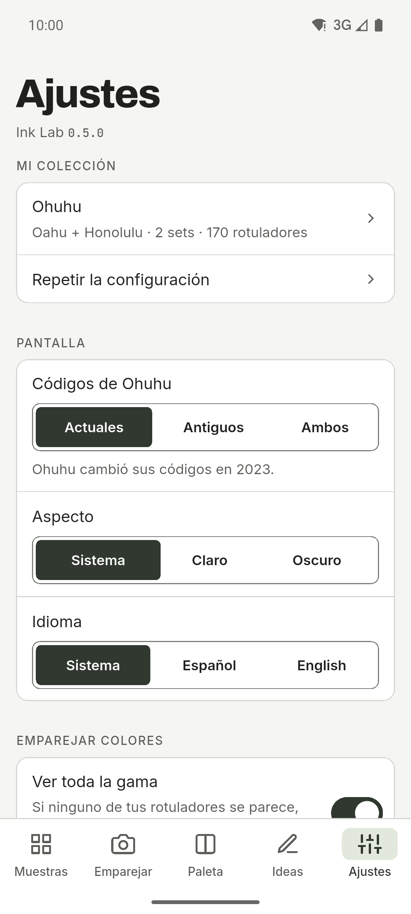

[English](README.md) · **Español**

  

# Ink Lab

Compañero de muestras y paletas para quien dibuja con rotuladores de alcohol.
Busca el código de un color, descubre qué rotulador de tu colección se parece más
a una foto y construye paletas con teoría del color usando solo los rotuladores
que tienes. Para Android, con modo claro y oscuro, raíl lateral en tablets y
textos en español e inglés.

**Gratis · Sin anuncios · Sin cuenta · Sin conexión · Código abierto**

La IA es opcional y está apagada de serie.

## Descargas

  
  <!--
  
  
  -->

Android ya; iOS y Google Play próximamente.

Instalar el APK desde GitHub

1. Descarga el APK y `SHA256SUMS.txt` de la [última
   versión](https://github.com/dferrandizmont/ink-lab/releases/latest). Cada
   versión lleva los dos, así que puedes comprobar la descarga con
   `sha256sum -c SHA256SUMS.txt`.
2. Permite «instalar aplicaciones de origen desconocido» cuando el móvil lo
   pida y abre el APK.

## Capturas

  
  
  
  
  

Más capturas

  

Pulsa una captura para ampliarla.

## Funciones

- **Muestras:** el catálogo por código y nombre, con el hex de cada rotulador,
  búsqueda, filtro por tus packs y favoritos. En Ohuhu Oahu indica además dónde
  está cada rotulador en la tarjeta de colores.
- **Emparejar con una foto:** haz una foto o elige una de la galería, toca un
  punto y la app te dice qué rotulador de tu colección se le parece más.
- **Paletas con teoría del color:** elige un color base y obtén armonías
  (complementarios, análogos, complementarios divididos, tríada, cuadrado,
  rectángulo, monocromo y sombra), resueltas siempre con los rotuladores que
  tienes.
- **Ideas:** retos y técnicas con una paleta que tiene en cuenta tu colección
  activa.
- **Dos marcas:** Ohuhu (Oahu, Honolulu y Kaala, 503 colores, con el código nuevo
  y el antiguo) y DecoTime (313 colores, con selección de rotuladores propios,
  porque se vende en sets cerrados).
- **IA opcional:** o bien **en el móvil** (Gemini Nano, en Android compatible), o
  bien con **tu propia clave de OpenRouter**. Si no la activas, la app nunca usa
  la red.
- **Copia de seguridad:** exporta e importa tus colecciones, favoritos, paletas y
  ajustes como texto JSON, sin cuenta.

## Privacidad

Todo se guarda en el móvil. No hay cuentas, servidor propio, analítica, anuncios
ni rastreo. La cámara y la galería solo se usan al emparejar una foto, y la foto
nunca sale del dispositivo.

[Política de privacidad](https://dferrandizmont.github.io/ink-lab/privacidad/) ·
[Detalle técnico](docs/privacy.md) · Soporte: **dev@mainshai.com**.

## Novedades

Consulta el [CHANGELOG.md](CHANGELOG.md).

## Contribuir

Los fallos, las ideas y las traducciones son bienvenidos. Cómo compilar, probar y
colaborar: [CONTRIBUTING.es.md](CONTRIBUTING.es.md).

## Licencia

Código [MIT](LICENSE), Copyright (c) 2026 Daniel Mont Ferrandiz. Documentación y
textos propios: [CC BY-SA 4.0](LICENSE-CONTENT.es.md). Los datos de los catálogos
son referencias factuales de terceros y quedan fuera de MIT y de CC BY-SA 4.0;
las fuentes tipográficas (SIL OFL 1.1) y los materiales de terceros conservan
sus licencias, detalladas en [NOTICE.md](NOTICE.md).

Proyecto independiente: **no está afiliado, patrocinado ni respaldado por Ohuhu
ni por DecoTime**. «Ohuhu», «Oahu» y «DecoTime» son marcas de sus propietarios.
Las fuentes públicas y los avisos completos están en [NOTICE.md](NOTICE.md).

Para comunicar una vulnerabilidad: [SECURITY.es.md](SECURITY.es.md).
