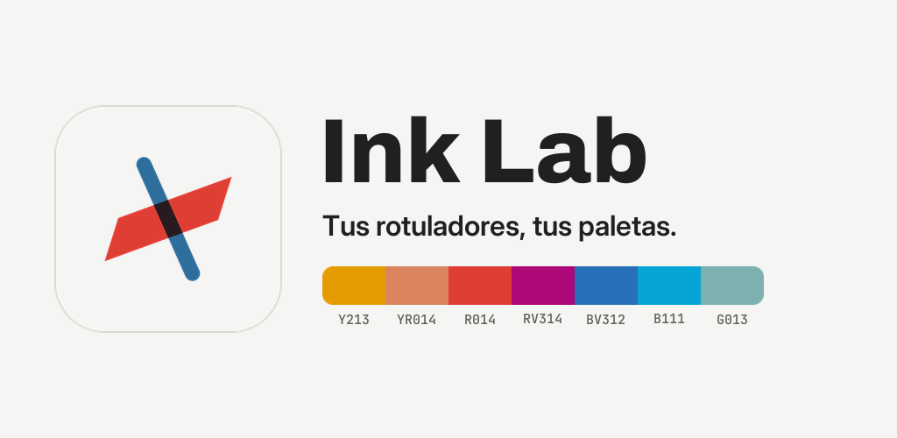
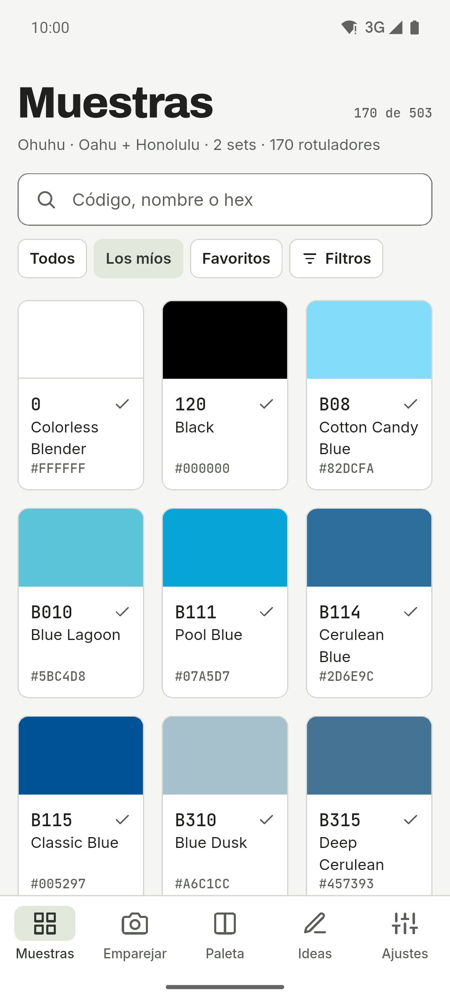
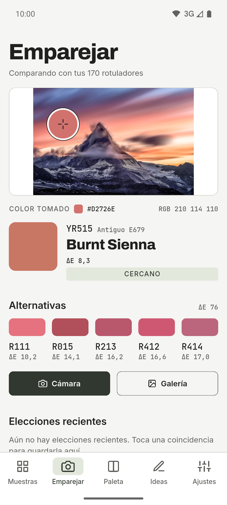
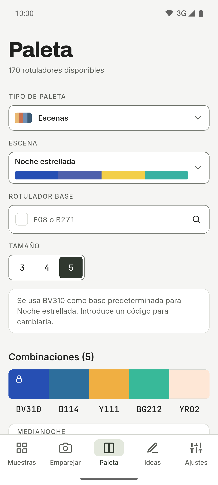
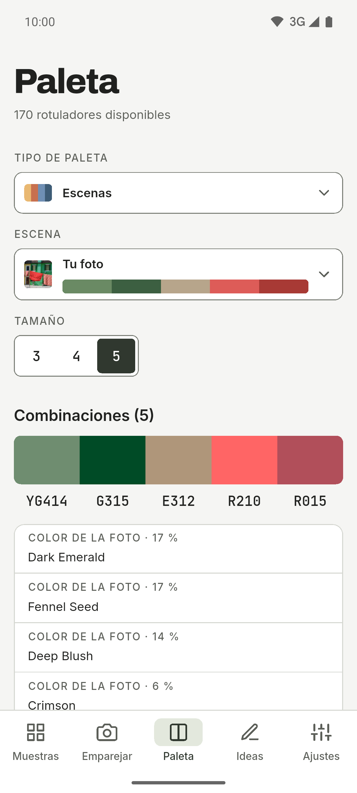
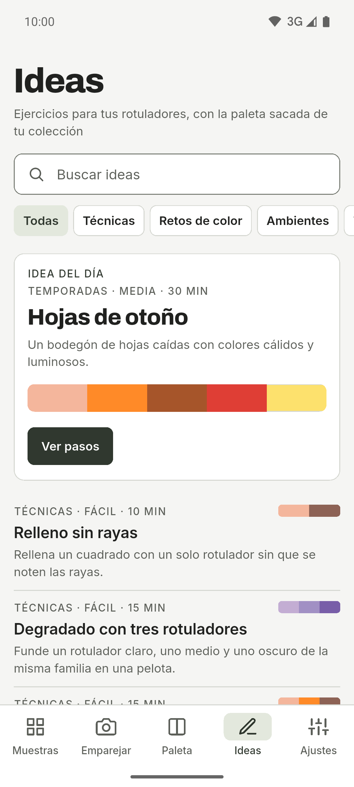
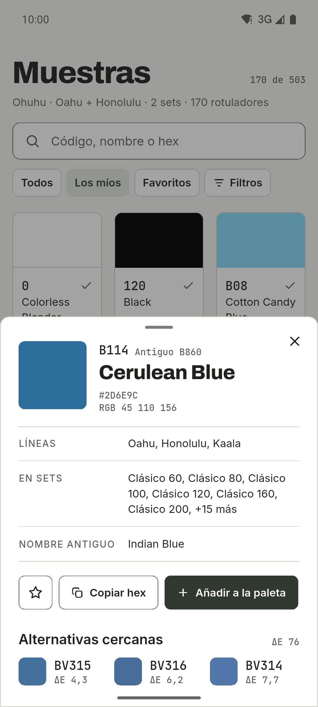
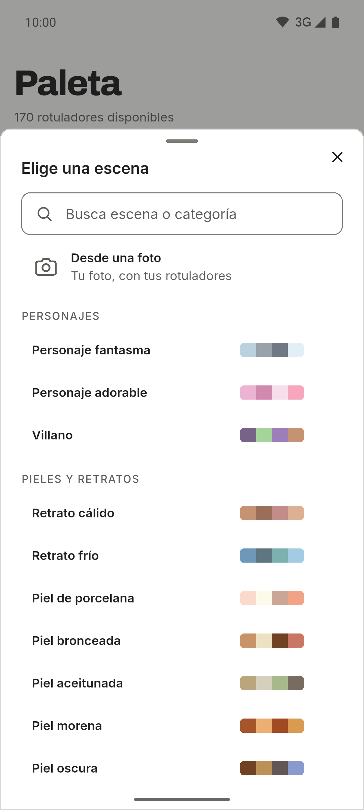
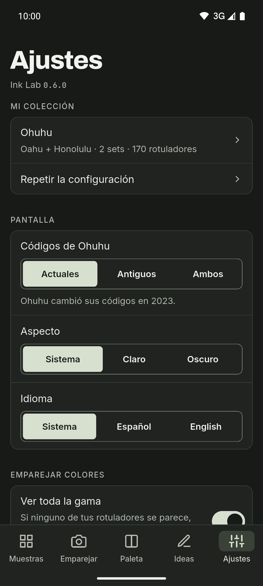

[English](README.md) · **Español**

  

# Ink Lab

Compañero de muestras y paletas para quien dibuja con rotuladores de alcohol.
Busca el código de un color, descubre qué rotulador de tu colección se parece más
a una foto y construye paletas con teoría del color usando solo los rotuladores
que tienes. Para Android, con modo claro y oscuro, raíl lateral en tablets y
textos en español e inglés.

**Gratis · Sin anuncios · Sin cuenta · Sin conexión · Código abierto**

La IA es opcional y está apagada de serie.

## Descargas

  
  
  <!--
  
  -->

Android en GitHub y en prueba cerrada en Google Play. iOS, más adelante.

Únete a la beta de Google Play

Ink Lab está en prueba cerrada en Google Play y cualquiera puede apuntarse:

1. Únete al grupo de testers: [ink-lab-testers](https://groups.google.com/g/ink-lab-testers). Con tu cuenta de Google, pulsa «Unirse al grupo».
2. Acepta la prueba desde el móvil o el ordenador: [play.google.com/apps/testing/es.inklab.app](https://play.google.com/apps/testing/es.inklab.app).
3. Instala la app desde Google Play. Se actualizará sola.

Si puedes, quédate en la prueba al menos 14 días y úsala de vez en cuando (por ejemplo, busca el color de una foto): Google exige 12 testers durante 14 días para publicarla para todo el mundo. Los comentarios, a inklab@mainshai.com.

Instala el APK desde GitHub

1. Descarga el APK y `SHA256SUMS.txt` de la [última
   versión](https://github.com/dferrandizmont/ink-lab/releases/latest). Cada
   versión lleva los dos, así que puedes comprobar la descarga con
   `sha256sum -c SHA256SUMS.txt`.
2. Permite «instalar aplicaciones de origen desconocido» cuando el móvil lo
   pida y abre el APK.

## Capturas

  
  
  
  
  

Más capturas

  
  
  

Pulsa una captura para ampliarla.

## Funciones

- **Mis rotuladores.** Una colección por marca, hecha con las series que usas,
  los sets que tienes y los rotuladores sueltos. Una guía corta la prepara al
  empezar.
- **Muestras.** El catálogo por código y nombre, con el hex de cada rotulador,
  búsqueda, filtros, tus rotuladores y favoritos. En Ohuhu Oahu indica además dónde
  está cada rotulador en la tarjeta de colores.
- **Emparejar con una foto.** Haz una foto o elige una de la galería, toca un
  punto y la app te dice qué rotulador de tu colección se le parece más, o te
  avisa si ninguno se parece.
- **Paletas con teoría del color.** Elige un color base y obtén armonías
  (complementarios, análogos, complementarios divididos, tríada, cuadrado,
  rectángulo, monocromo y sombra), resueltas siempre con los rotuladores que
  tienes.
- **Escenas.** 67 recetas listas en 11 categorías (pieles, cielo y agua,
  naturaleza, animales, comida, fantasía…), con buscador y los papeles de cada
  color.
- **Escena desde una foto.** La app saca los colores principales de una foto y
  los convierte en los rotuladores más parecidos que tienes.
- **Dos marcas.** Ohuhu (Oahu, Honolulu y Kaala, 503 colores, con el código nuevo
  y el antiguo) y DecoTime (313 colores, con selección de rotuladores propios,
  porque se vende en sets cerrados).

Más funciones

- **Ideas.** Retos y técnicas con una paleta que tiene en cuenta tu colección
  activa.
- **IA opcional.** O bien **en el móvil** (Gemini Nano, en Android compatible), o
  bien con **tu propia clave de OpenRouter**. La IA en el móvil usa ML Kit de
  Google, que envía a Google diagnósticos de uso, nunca tus peticiones, colores
  ni fotos. Si no la activas, la app nunca usa la red.
- **Copia de seguridad.** Exporta e importa tus colecciones, favoritos, paletas y
  ajustes como texto JSON, sin cuenta.

## Privacidad

Todo se guarda en el móvil. No hay cuentas, servidor propio, analítica propia,
anuncios ni rastreo. Si no activas la IA, la app nunca usa la red. La IA en el
móvil usa ML Kit de Google, que envía a Google diagnósticos de uso, nunca tus
peticiones, colores ni fotos. La cámara y la galería solo se usan al emparejar
una foto o al crear una escena desde ella, y la foto nunca sale del dispositivo.

[Web](https://inklab.mainshai.com/es/) · [Política de privacidad](https://inklab.mainshai.com/es/privacy/) ·
[Detalle técnico](docs/privacy.md) · Soporte: **inklab@mainshai.com**.

## Novedades

Consulta el [CHANGELOG.md](CHANGELOG.md).

## Contribuir

Los fallos, las ideas y las traducciones son bienvenidos. Cómo compilar, probar y
colaborar: [CONTRIBUTING.es.md](CONTRIBUTING.es.md).

## Licencia

Código [MIT](LICENSE), Copyright (c) 2026 Daniel Mont Ferrandiz. Documentación y
textos propios: [CC BY-SA 4.0](LICENSE-CONTENT.es.md). Los datos de los catálogos
son referencias factuales de terceros y quedan fuera de MIT y de CC BY-SA 4.0;
las fuentes tipográficas (SIL OFL 1.1) y los materiales de terceros conservan
sus licencias, detalladas en [NOTICE.md](NOTICE.md).

Proyecto independiente: **no está afiliado, patrocinado ni respaldado por Ohuhu
ni por DecoTime**. «Ohuhu», «Oahu» y «DecoTime» son marcas de sus propietarios.
Las fuentes públicas y los avisos completos están en [NOTICE.md](NOTICE.md).

Para comunicar una vulnerabilidad: [SECURITY.es.md](SECURITY.es.md).
