[English](README.md) · **Español** · [Deutsch](README.de.md) · [Français](README.fr.md) · [Português](README.pt.md) · [Italiano](README.it.md)

  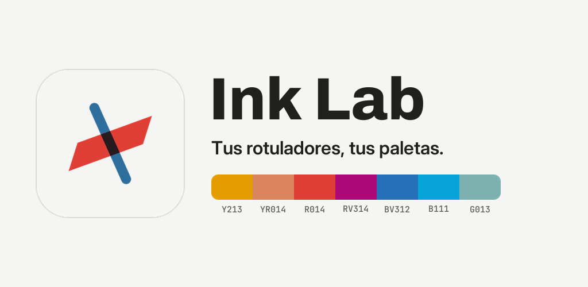

# Ink Lab

Compañero de muestras y paletas para quien dibuja con rotuladores de alcohol. Busca el
código de un color, descubre qué rotulador tuyo se parece más a una foto y crea paletas
con teoría del color usando solo tus rotuladores. App para Android, iPhone y iPad, con
modo claro y oscuro, diseño para tablets y seis idiomas.

**Gratis · Sin anuncios · Sin cuenta · Sin conexión · Código abierto**

La IA es opcional y está apagada de serie.

## Descargas

  
  
  

iPhone y iPad en la App Store. Android en GitHub y en prueba cerrada en Google Play.

Únete a la beta de Google Play

1. Únete al grupo de testers: [ink-lab-testers](https://groups.google.com/g/ink-lab-testers). Con tu cuenta de Google, pulsa «Unirse al grupo».
2. Acepta la prueba: [play.google.com/apps/testing/es.inklab.app](https://play.google.com/apps/testing/es.inklab.app).
3. Instala la app desde Google Play. Se actualizará sola.

Quédate 14 días: Google exige 12 testers durante 14 días antes de publicarla.
Comentarios: inklab@mainshai.com.

Instala el APK desde GitHub

1. Descarga el APK y `SHA256SUMS.txt` de la [última
   versión](https://github.com/dferrandizmont/ink-lab/releases/latest). Comprueba la descarga con
   `sha256sum -c SHA256SUMS.txt`.
2. Permite «instalar aplicaciones de origen desconocido» cuando el móvil lo
   pida y abre el APK.

## Capturas

  <a href="docs/readme/es/01-swatches.png">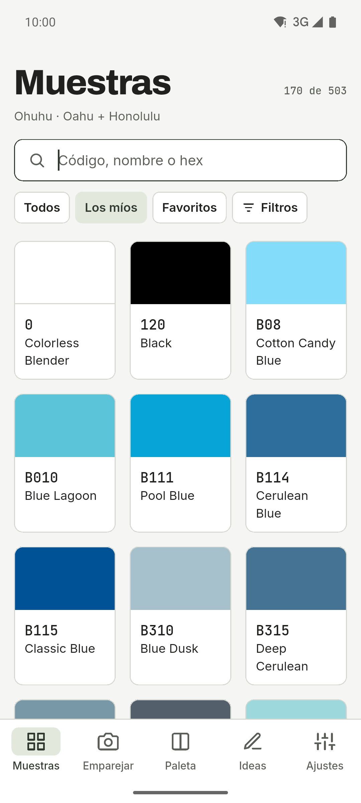</a>
  <a href="docs/readme/es/02-swatch-detail.png">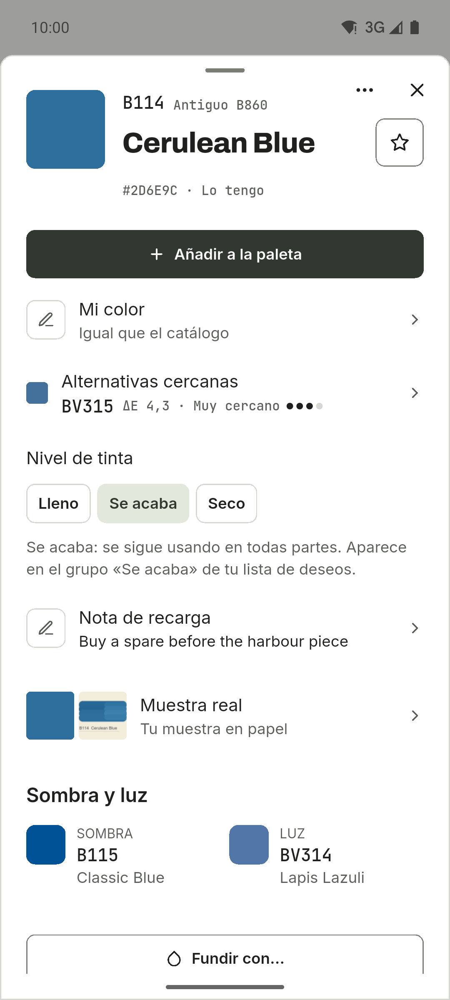</a>
  <a href="docs/readme/es/03-match.png">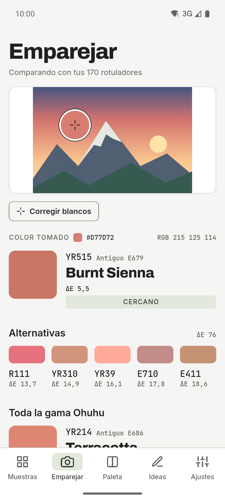</a>
  <a href="docs/readme/es/04-palette.png">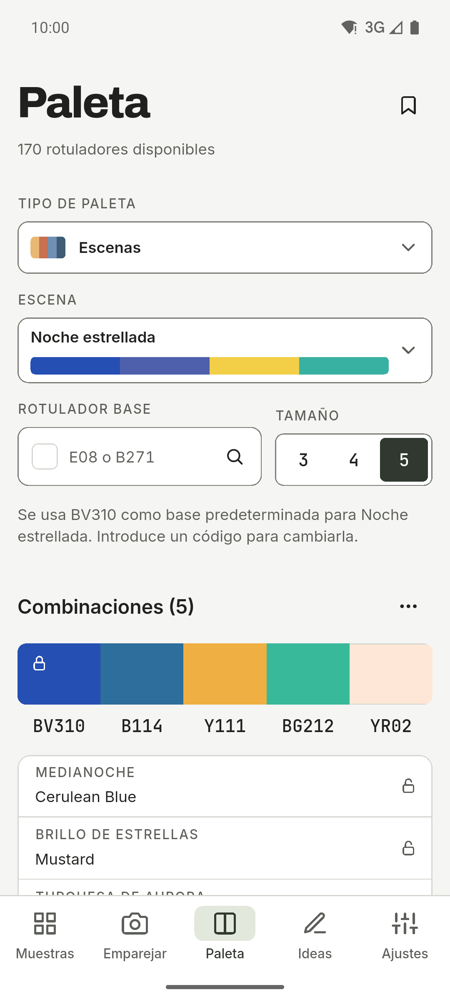</a>
  <a href="docs/readme/es/05-diary.png">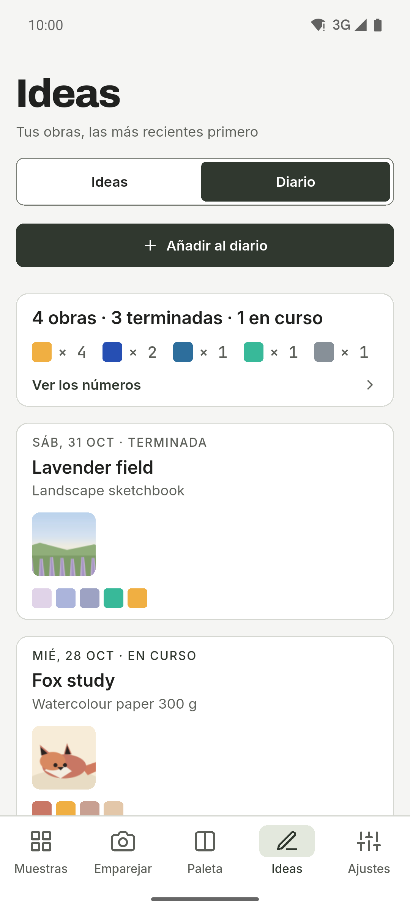</a>

Más capturas

  <a href="docs/readme/es/06-photo-scene.png">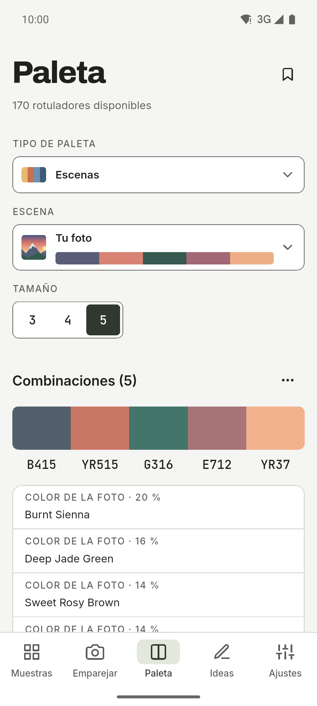</a>
  <a href="docs/readme/es/07-ideas.png">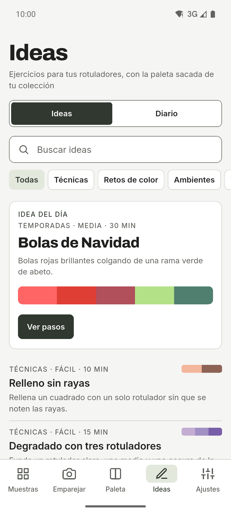</a>
  <a href="docs/readme/es/08-collection.png">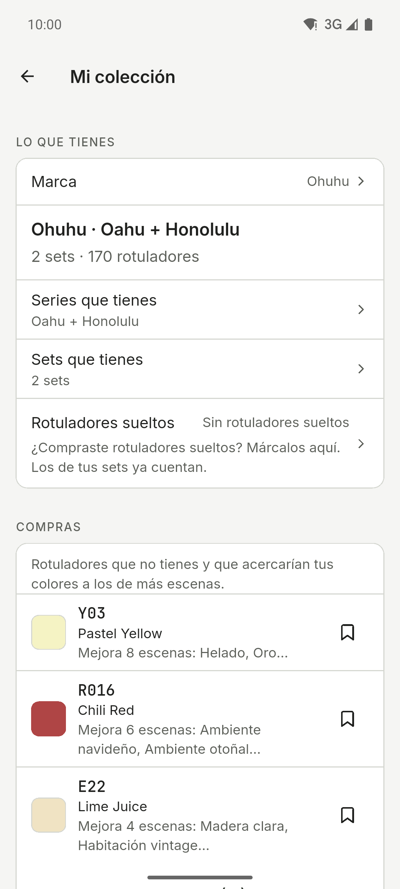</a>
  <a href="docs/readme/es/09-settings-dark.png">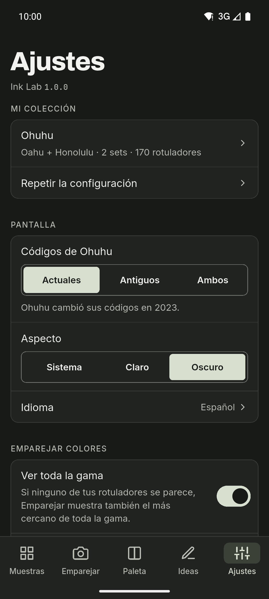</a>
  <a href="docs/readme/es/10-colour-map.png">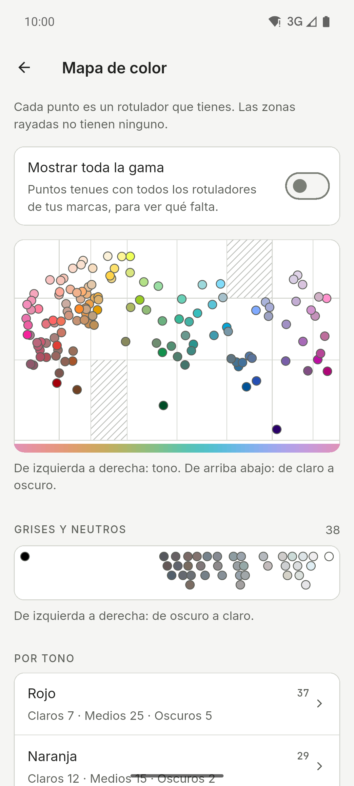</a>

Pulsa una captura para ampliarla.

## Funciones

- **Quince marcas, 3420 colores.** Ohuhu, DecoTime, Copic (Sketch, Ciao y Classic),
  Finecolour, Touch Twin, Promarker, Promarker Brush, Prismacolor Premier, Spectrum
  Noir, Arrtx, ZIG Kurecolor, Graph'it, Marvy Le Plume, Blick Studio Brush y Artist's
  Loft, con buscador de marcas y «En otras marcas».
- **Detalle del rotulador.** Nivel de tinta y nota de recarga, una foto de tu muestra
  real, sombra y luz, «Mezclar con…» y aviso de casi duplicados.
- **Emparejar.** Toca un punto de una foto para encontrar el rotulador de tu colección
  más cercano, corrige los blancos y mira los valores en gris.
- **Paletas y escenas.** Armonías de teoría del color, degradados y 67 escenas listas,
  con modo caballete y paletas que compartes o importas como texto.
- **Herramientas.** Un mapa de color de tu colección, un traductor de recetas de otras
  marcas, tus propias recetas de mezcla con foto, y exportar o importar como CSV o
  texto.
- **Diario de dibujos.** Un registro de lo que pintas, con sus fotos, los rotuladores
  que usaste y los números que hay detrás.
- **Copia de seguridad.** Guarda todo en un archivo `.zip`, fotos incluidas; Ajustes te
  dice cuándo hiciste la última.

Más funciones

- **Compras.** Una lista de deseos, los rotuladores secos y qué comprar ahora.
- **Visión del color.** Mira una paleta como la ve alguien con daltonismo.
- **Carta de muestras para imprimir.** Páginas A4 con una casilla rotulada para cada
  rotulador que tienes.
- **Ideas.** Ejercicios y técnicas con sus propias paletas, y tus favoritas.
- **Muestras y tu propio color.** Códigos, nombres y valores hex (un hex encuentra los
  rotuladores más cercanos), más el color que tu rotulador da de verdad.
- **IA, si quieres.** Sugerencias de paletas opcionales: Gemini Nano en el móvil u
  OpenRouter con tu propia clave.
- **Widget «Idea del día».** Solo en Android: el ejercicio de hoy, con los colores de
  tus rotuladores, en la pantalla de inicio.
- **Accesos directos.** Desde el icono de la app, a Emparejar, una paleta nueva o la
  búsqueda de muestras.
- **Ajustes.** Licencias de código abierto, «Enviar comentarios» y un registro de
  errores local que puedes compartir o borrar.

## Privacidad

Los datos se guardan en el móvil: sin cuentas, servidor propio, analítica, anuncios ni
rastreo; sin IA, no se usa la red. El ML Kit de la IA en el móvil envía a Google
diagnósticos de uso, nunca peticiones, colores ni fotos. El acceso a la cámara y la
galería solo sirve para emparejar colores, crear escenas, definir tu propio color y
añadir fotos al diario, a tus muestras reales y a tus recetas de mezcla; esas fotos se
procesan en el dispositivo, y las que guardas se quedan en la carpeta privada de la app
y nunca se suben. Al compartir una paleta, una carta o la copia `.zip`, el archivo solo
se entrega a la app que elijas, y nada más.

[Web](https://inklab.mainshai.com/es/) · [Política de privacidad](https://inklab.mainshai.com/es/privacy/) ·
[Detalle técnico](docs/privacy.md) · Soporte: **inklab@mainshai.com**.

## Novedades

La versión 1.2.4 mantiene la paleta en pantalla al cambiar de marca, y deja Paleta más clara en las tablets. La versión 1.2.3 mantiene tus rotuladores donde están: bloquear un color ya no lo mueve, añadir una familia ya no borra los que importaste, sin rotuladores la app lo dice en vez de usar toda la gama, y puedes mezclar todas tus marcas. La versión 1.2.2 corrige lo que encontró una revisión de todas las pantallas: las paletas guardadas se abren con un toque, Atrás en Android vuelve a Muestras y los textos son más claros. La versión 1.2.1 muestra enteras las descripciones de las ideas y corrige pequeños detalles de pantalla. La 1.2.0 trajo 100 ideas en vez de 28, agrupadas por dificultad y por estación para encontrarlas
fácilmente, y un menú lateral más limpio en tablets. La lista completa está en
[CHANGELOG.md](CHANGELOG.md) y en las
[versiones](https://github.com/dferrandizmont/ink-lab/releases).

## Contribuir

Los fallos, las ideas y las traducciones son bienvenidos. Cómo compilar, probar y
colaborar: [CONTRIBUTING.es.md](CONTRIBUTING.es.md).

## Licencia

Código [MIT](LICENSE), Copyright (c) 2026 Daniel Mont Ferrandiz. Documentación y
textos propios: [CC BY-SA 4.0](LICENSE-CONTENT.es.md). Los datos de los catálogos
son referencias factuales de terceros y quedan fuera de ambas licencias; las
fuentes tipográficas (SIL OFL 1.1) y los materiales de terceros conservan sus
licencias.

Proyecto independiente: **no está afiliado, patrocinado ni respaldado por ninguna
de estas marcas de rotuladores**. Los nombres de las marcas anteriores son marcas de sus respectivos propietarios.
Avisos completos: [NOTICE.md](NOTICE.md).

Para comunicar una vulnerabilidad: [SECURITY.es.md](SECURITY.es.md).
