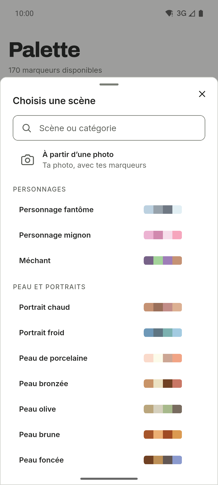
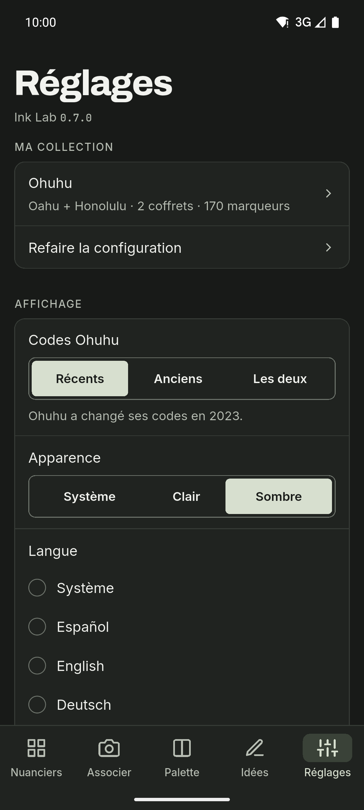

[English](README.md) · [Español](README.es.md) · [Deutsch](README.de.md) · **Français** · [Português](README.pt.md) · [Italiano](README.it.md)

  

# Ink Lab

Compagnon de nuanciers et de palettes pour celles et ceux qui dessinent avec des
marqueurs à alcool. Retrouve le code d’une couleur, découvre quel marqueur de ta
collection se rapproche le plus d’une photo et crée des palettes selon la théorie
des couleurs, uniquement avec les marqueurs que tu possèdes. Appli Android avec
thèmes clair et sombre, barre de navigation latérale sur tablette et six
langues.

**Gratuit · Sans publicité · Sans compte · Hors ligne · Open source**

L’IA est facultative et désactivée par défaut.

## Téléchargement

  
  
  <!--
  
  -->

Android sur GitHub et en test fermé sur Google Play. iOS arrivera plus tard.

Rejoindre la bêta Google Play

Tout le monde peut rejoindre le test fermé :

1. Rejoins le groupe [ink-lab-testers](https://groups.google.com/g/ink-lab-testers). Connecte-toi à Google et appuie sur « Rejoindre le groupe ».
2. Accepte le test : [play.google.com/apps/testing/es.inklab.app](https://play.google.com/apps/testing/es.inklab.app).
3. Installe l’appli depuis Google Play. Elle se met à jour toute seule.

Reste 14 jours : Google exige 12 testeurs pendant 14 jours avant la
publication. Retours : inklab@mainshai.com.

Installer l’APK depuis GitHub

1. Télécharge l’APK et `SHA256SUMS.txt` de la [dernière
   version](https://github.com/dferrandizmont/ink-lab/releases/latest). Vérifie le téléchargement avec
   `sha256sum -c SHA256SUMS.txt`.
2. Autorise l’installation depuis des sources inconnues quand le téléphone le
   demande, puis ouvre l’APK.

## Captures d’écran

  
  
  
  
  

Plus de captures d’écran

  
  
  

Touche une capture pour l’agrandir.

## Fonctionnalités

- **Mes marqueurs.** Un guide de démarrage compose la collection de chaque marque
  à partir de tes séries, coffrets et marqueurs à l’unité.
- **Associer une photo.** Touche un point pour trouver ton marqueur le plus
  proche ; corrige les blancs pour que les couleurs échantillonnées soient fidèles.
- **Ta propre couleur.** La couleur du catalogue est une estimation ; définis
  celle que ton marqueur donne vraiment, par code hex ou par photo.
- **Palettes et dégradés.** Harmonies basées sur la théorie des couleurs et
  dégradés de trois à cinq marqueurs, du plus clair au plus foncé.
- **Scènes.** 67 recettes en 11 catégories, chacune avec ses rôles de couleur.
- **Journal de dessins.** Un suivi de tes réalisations : date, papier, marqueurs,
  notes et jusqu’à quatre photos.
- **Trois marques.** Ohuhu (503 couleurs), DecoTime (313) et Copic (358), avec
  sélection individuelle des marqueurs.

Plus de fonctionnalités

- **Nuanciers.** Codes, noms et valeurs hex, avec recherche, filtres et favoris.
- **Scène à partir d’une photo.** Associe les couleurs principales d’une photo
  aux marqueurs de ta collection qui s’en rapprochent le plus.
- **Partager et imprimer.** Partage une palette en image ou crée un nuancier A4
  imprimable.
- **Liste de souhaits et marqueurs à sec.** Note les marqueurs à acheter et
  marque ceux qui ne fonctionnent plus comme « À sec » pour que l’appli les
  ignore.
- **Idées et IA.** Défis et techniques, plus Gemini Nano en option sur les
  appareils Android compatibles ou OpenRouter avec ta propre clé d’API.
- **Sauvegarde.** Exporte et importe tes données en texte JSON, sans les photos.

## Confidentialité

Tes données restent sur ton téléphone : pas de compte, pas de serveur à nous, pas
d’analyse d’utilisation par le développeur, pas de publicité ni de suivi ; sans
l’IA, le réseau n’est jamais utilisé. ML Kit de l’IA sur l’appareil envoie à
Google des diagnostics d’utilisation, jamais tes demandes, tes couleurs ni tes
photos. L’accès à la caméra et à la galerie ne sert qu’à associer des couleurs,
créer des scènes, définir ta propre couleur et ajouter des photos au journal ; les
photos d’association et de scènes sont traitées sur l’appareil, et celles du
journal restent dans le dossier privé de l’appli et ne sont jamais envoyées. Quand
tu partages une palette ou un nuancier, l’image ne va qu’à l’appli que tu
choisis.

[Site](https://inklab.mainshai.com/fr/) · [Politique de confidentialité](https://inklab.mainshai.com/fr/privacy/) ·
[Détails techniques](docs/privacy.en.md) · Support : **inklab@mainshai.com**.

## Nouveautés

La 0.7.0 apporte le journal de dessins, les dégradés, tes propres couleurs avec la
correction des blancs, la liste de souhaits, les marqueurs à sec, les nuanciers
imprimables et le partage. La liste complète est dans [CHANGELOG.md](CHANGELOG.md).

## Contribuer

Les bugs, les idées et les traductions sont les bienvenus. Comment compiler,
tester et contribuer : [CONTRIBUTING.md](CONTRIBUTING.md).

## Licence

Code sous [MIT](LICENSE), Copyright (c) 2026 Daniel Mont Ferrandiz. Documentation
et textes du projet : [CC BY-SA 4.0](LICENSE-CONTENT.md). Les données des catalogues
sont des références factuelles de tiers et sortent des deux licences ; les polices
(SIL OFL 1.1) et les autres éléments tiers gardent leurs propres conditions,
listées dans [NOTICE.md](NOTICE.md).

Un projet indépendant : **sans lien avec Ohuhu, DecoTime ou Copic, sans
parrainage ni approbation de leur part**. « Ohuhu », « Oahu », « DecoTime » et « Copic » sont des marques de leurs propriétaires.
Les sources et les mentions complètes sont dans [NOTICE.md](NOTICE.md).

Signaler une faille : [SECURITY.md](SECURITY.md).
