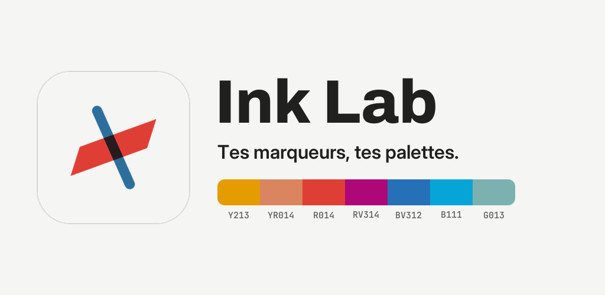
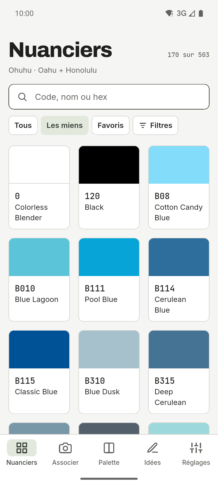
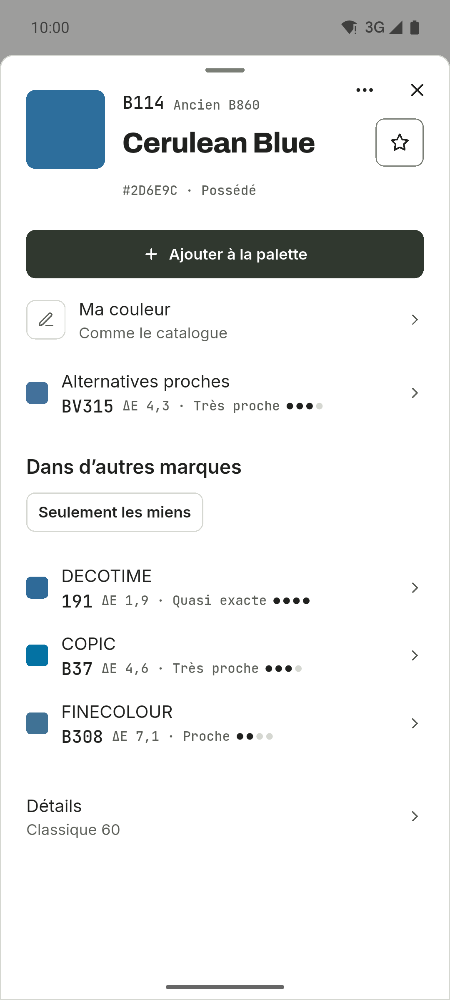
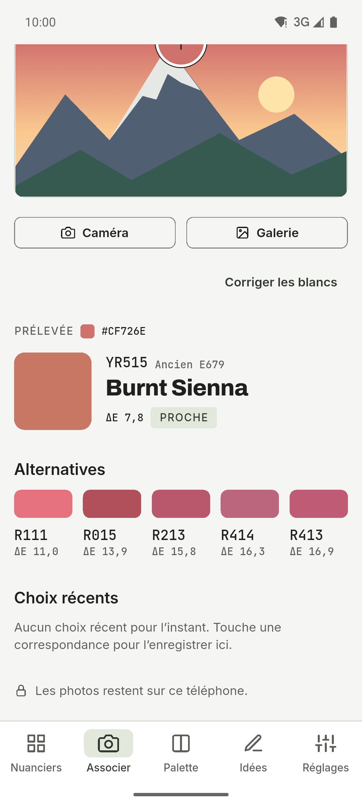
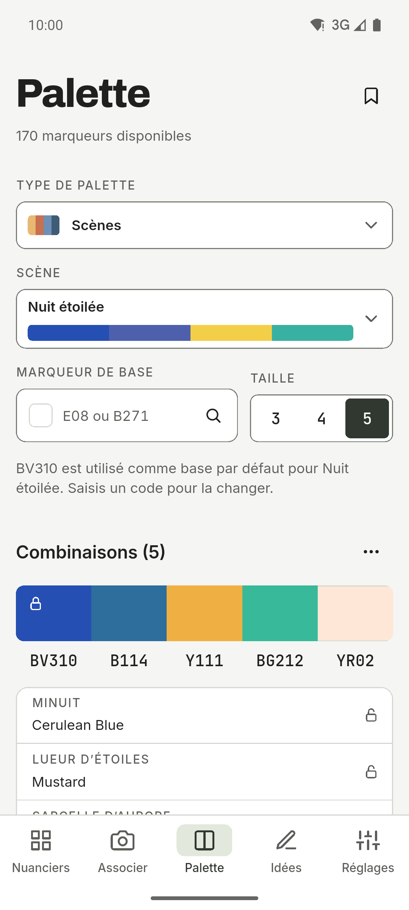
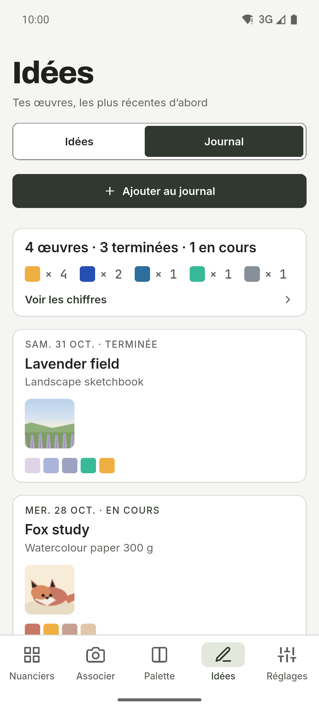
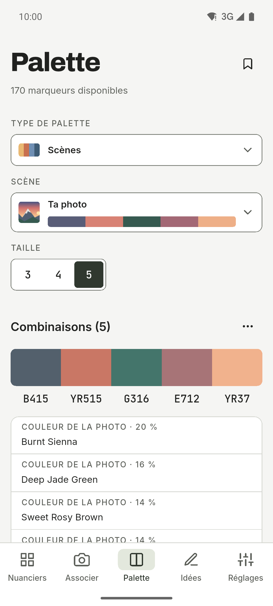
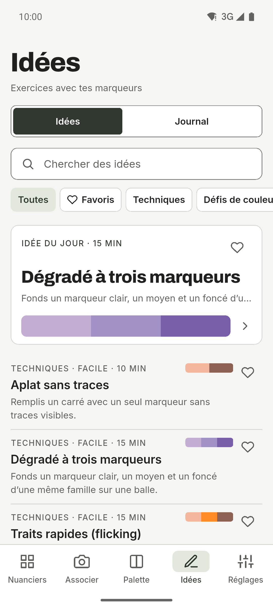
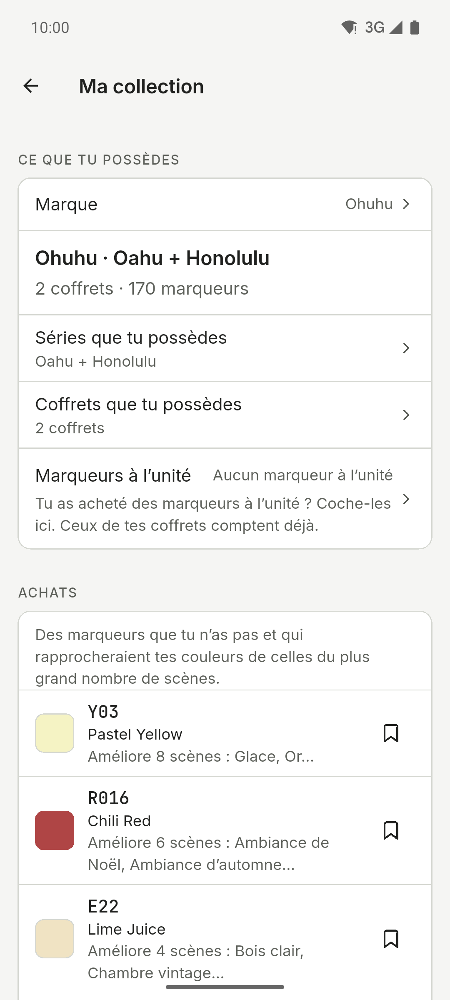
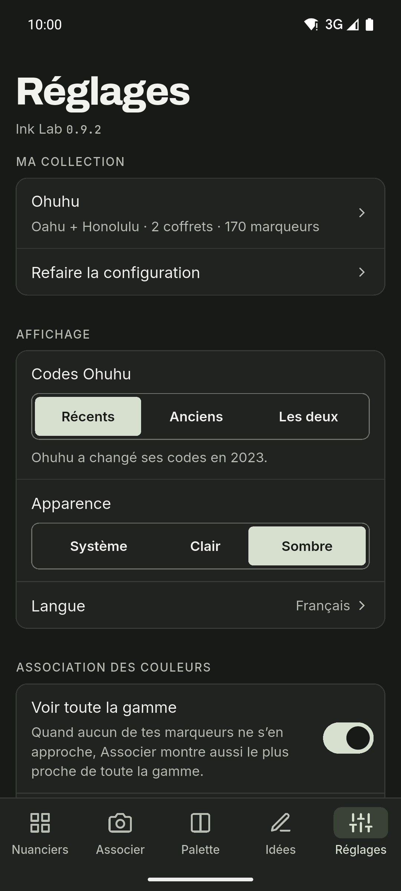

[English](README.md) · [Español](README.es.md) · [Deutsch](README.de.md) · **Français** · [Português](README.pt.md) · [Italiano](README.it.md)

  

# Ink Lab

Compagnon de nuanciers et de palettes pour celles et ceux qui dessinent avec des
marqueurs à alcool. Retrouve le code d’une couleur, découvre quel marqueur de ta
collection se rapproche le plus d’une photo et crée des palettes selon la théorie
des couleurs, uniquement avec les marqueurs que tu possèdes. Appli Android avec
thèmes clair et sombre, barre de navigation latérale sur tablette et six
langues.

**Gratuit · Sans publicité · Sans compte · Hors ligne · Open source**

L’IA est facultative et désactivée par défaut.

## Téléchargement

  
  
  <!--
  
  -->

Android sur GitHub et en test fermé sur Google Play. iOS arrivera plus tard.

Rejoindre la bêta Google Play

1. Rejoins le groupe [ink-lab-testers](https://groups.google.com/g/ink-lab-testers). Connecte-toi à Google et appuie sur « Rejoindre le groupe ».
2. Accepte le test : [play.google.com/apps/testing/es.inklab.app](https://play.google.com/apps/testing/es.inklab.app).
3. Installe l’appli depuis Google Play. Elle se met à jour toute seule.

Reste 14 jours : Google exige 12 testeurs pendant 14 jours avant la
publication. Retours : inklab@mainshai.com.

Installer l’APK depuis GitHub

1. Télécharge l’APK et `SHA256SUMS.txt` de la [dernière
   version](https://github.com/dferrandizmont/ink-lab/releases/latest). Vérifie le téléchargement avec
   `sha256sum -c SHA256SUMS.txt`.
2. Autorise l’installation depuis des sources inconnues quand le téléphone le
   demande, puis ouvre l’APK.

## Captures d’écran

  
  
  
  
  

Plus de captures d’écran

  
  
  
  

Touche une capture pour l’agrandir.

## Fonctionnalités

- **Journal de dessins.** Un suivi de ce que tu peins, avec ses photos, les
  marqueurs utilisés et les chiffres qui vont avec.
- **Quatre marques.** Ohuhu (503 couleurs), DecoTime (313), Copic (358) et
  Finecolour (480), avec le marqueur le plus proche de chaque autre marque dans
  « Dans d’autres marques ».
- **Associer.** Touche un point d’une photo pour trouver le marqueur de ta
  collection le plus proche, et corrige les blancs.
- **Palettes et scènes.** Harmonies de la théorie des couleurs, dégradés et 67
  scènes prêtes en 11 catégories.
- **Sauvegarde.** Enregistre tout dans un fichier `.zip`, avec les photos du
  journal dedans.
- **Achats.** Une liste de souhaits, les marqueurs à sec et ce qu’il faut racheter
  ensuite.

Plus de fonctionnalités

- **Vision des couleurs.** Prévisualise une palette comme la voit une personne
  atteinte de protanopie, deutéranopie, tritanopie ou achromatopsie.
- **Nuancier imprimable.** Des pages A4 avec une case étiquetée pour chaque
  marqueur que tu possèdes.
- **Idées.** Des exercices et des techniques avec leurs propres palettes, et tes
  favoris.
- **Nuanciers et ta propre couleur.** Codes, noms et valeurs hex, plus la couleur
  que ton marqueur donne vraiment.
- **Partager.** Envoie une palette, un nuancier ou une entrée du journal à une
  autre appli sous forme d’image.
- **L’IA, si tu veux.** Des suggestions de palettes en option : Gemini Nano sur
  l’appareil, ou OpenRouter avec ta propre clé.

## Confidentialité

Tes données restent sur ton téléphone : pas de compte, pas de serveur à nous, pas
d’analyse, pas de publicité ni de suivi ; sans l’IA, le réseau n’est jamais
utilisé. ML Kit de l’IA sur l’appareil envoie à Google des diagnostics
d’utilisation, jamais tes demandes, tes couleurs ni tes photos. L’accès à la
caméra et à la galerie ne sert qu’à associer des couleurs, créer des scènes,
définir ta propre couleur et ajouter des photos au journal ; ces photos sont
traitées sur l’appareil, et celles du journal restent dans le dossier privé de
l’appli et ne sont jamais envoyées. Quand tu partages une palette, un nuancier ou
la sauvegarde `.zip`, le fichier ne va qu’à l’appli que tu choisis, et nulle part
ailleurs.

[Site](https://inklab.mainshai.com/fr/) · [Politique de confidentialité](https://inklab.mainshai.com/fr/privacy/) ·
[Détails techniques](docs/privacy.en.md) · Support : **inklab@mainshai.com**.

## Nouveautés

La version 0.9.2 est sortie. La série 0.9 a mis de l’ordre dans l’appli : une
fiche de marqueur plus calme, des écrans mieux rangés et des correctifs pour les
grandes tailles de texte. La liste complète est dans [CHANGELOG.md](CHANGELOG.md)
et dans les [versions](https://github.com/dferrandizmont/ink-lab/releases).

## Contribuer

Les bugs, les idées et les traductions sont les bienvenus. Comment compiler,
tester et contribuer : [CONTRIBUTING.md](CONTRIBUTING.md).

## Licence

Code sous [MIT](LICENSE), Copyright (c) 2026 Daniel Mont Ferrandiz. Documentation
et textes du projet : [CC BY-SA 4.0](LICENSE-CONTENT.md). Les données des
catalogues sont des références factuelles de tiers et sortent des deux licences ;
les polices (SIL OFL 1.1) et les autres éléments tiers gardent leurs propres
conditions.

Un projet indépendant : **sans lien avec Ohuhu, DecoTime, Copic ou Finecolour, sans
parrainage ni approbation de leur part**. « Ohuhu », « Oahu », « DecoTime », « Copic » et « Finecolour » sont des marques de leurs propriétaires.
Mentions complètes : [NOTICE.md](NOTICE.md).

Signaler une faille : [SECURITY.md](SECURITY.md).
