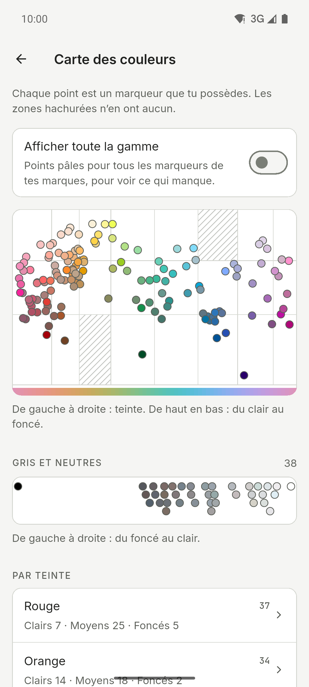

[English](README.md) · [Español](README.es.md) · [Deutsch](README.de.md) · **Français** · [Português](README.pt.md) · [Italiano](README.it.md)

  

# Ink Lab

Compagnon de nuanciers et de palettes pour celles et ceux qui dessinent avec des
marqueurs à alcool. Retrouve le code d’une couleur, découvre quel marqueur de ta
collection se rapproche le plus d’une photo et crée des palettes selon la théorie des
couleurs, uniquement avec les marqueurs que tu possèdes. Appli pour Android, iPhone et
iPad avec thèmes clair et sombre, mise en page pour tablettes et six langues.

**Gratuit · Sans publicité · Sans compte · Hors ligne · Open source**

L’IA est facultative et désactivée par défaut.

## Téléchargement

  
  
  

iPhone et iPad sur l’App Store. Android sur GitHub et en test fermé sur Google Play.

Rejoindre la bêta Google Play

1. Rejoins le groupe [ink-lab-testers](https://groups.google.com/g/ink-lab-testers). Connecte-toi à Google et appuie sur « Rejoindre le groupe ».
2. Accepte le test : [play.google.com/apps/testing/es.inklab.app](https://play.google.com/apps/testing/es.inklab.app).
3. Installe l’appli depuis Google Play. Elle se met à jour toute seule.

Reste 14 jours : Google exige 12 testeurs pendant 14 jours avant la
publication. Retours : inklab@mainshai.com.

Installer l’APK depuis GitHub

1. Télécharge l’APK et `SHA256SUMS.txt` de la [dernière
   version](https://github.com/dferrandizmont/ink-lab/releases/latest). Vérifie le téléchargement avec
   `sha256sum -c SHA256SUMS.txt`.
2. Autorise l’installation depuis des sources inconnues quand le téléphone le
   demande, puis ouvre l’APK.

## Captures d’écran

  
  
  
  
  

Plus de captures d’écran

  
  
  
  
  

Touche une capture pour l’agrandir.

## Fonctionnalités

- **Quinze marques, 3 420 couleurs.** Ohuhu, DecoTime, Copic (Sketch, Ciao et Classic),
  Finecolour, Touch Twin, Promarker, Promarker Brush, Prismacolor Premier, Spectrum
  Noir, Arrtx, ZIG Kurecolor, Graph'it, Marvy Le Plume, Blick Studio Brush et Artist's
  Loft, avec une recherche de marque et « Dans d’autres marques ».
- **Détail du marqueur.** Niveau d’encre et note de recharge, une photo de ton
  échantillon réel, ombre et lumière, « Mélanger avec… » et une alerte de quasi-doublon.
- **Associer.** Touche un point d’une photo pour trouver le marqueur de ta collection le
  plus proche, corrige les blancs et vérifie les valeurs en gris.
- **Palettes et scènes.** Harmonies de la théorie des couleurs, dégradés et 67 scènes
  prêtes, avec le mode chevalet et des palettes à partager ou importer en texte.
- **Outils.** Une carte des couleurs de ta collection, un traducteur de recettes
  d’autres marques, tes propres recettes de mélange avec photo, et l’export ou l’import
  en CSV ou en texte.
- **Journal de dessins.** Un suivi de ce que tu peins, avec ses photos, les marqueurs
  utilisés et les chiffres qui vont avec.
- **Sauvegarde.** Enregistre tout dans un fichier `.zip`, photos comprises ; les
  Réglages affichent la date de la dernière.

Plus de fonctionnalités

- **Achats.** Une liste de souhaits, les marqueurs à sec et ce qu’il faut racheter
  ensuite.
- **Vision des couleurs.** Vois une palette comme la voit une personne daltonienne.
- **Nuancier imprimable.** Des pages A4 avec une case étiquetée pour chaque marqueur que
  tu possèdes.
- **Idées.** Des exercices et des techniques avec leurs propres palettes, et tes
  favoris.
- **Nuanciers et ta propre couleur.** Codes, noms et valeurs hex (un code hex trouve les
  marqueurs les plus proches), plus la couleur que ton marqueur donne vraiment.
- **L’IA, si tu veux.** Des suggestions de palettes en option : Gemini Nano sur
  l’appareil, ou OpenRouter avec ta propre clé.
- **Widget « Idée du jour ».** Sur Android uniquement : l’exercice du jour, aux couleurs
  de tes marqueurs, sur l’écran d’accueil.
- **Raccourcis.** Depuis l’icône de l’appli, vers Associer, une nouvelle palette ou la
  recherche de nuanciers.
- **Réglages.** Licences open source, « Envoyer un retour » et un historique des erreurs
  local que tu peux partager ou effacer.

## Confidentialité

Tes données restent sur ton téléphone : pas de compte, pas de serveur à nous, pas
d’analyse, pas de publicité ni de suivi ; sans l’IA, le réseau n’est jamais utilisé. ML
Kit de l’IA sur l’appareil envoie à Google des diagnostics d’utilisation, jamais tes
demandes, tes couleurs ni tes photos. L’accès à la caméra et à la galerie ne sert qu’à
associer des couleurs, créer des scènes, définir ta propre couleur et ajouter des photos
au journal, à tes échantillons réels et à tes recettes de mélange ; ces photos sont
traitées sur l’appareil, et celles que tu gardes restent dans le dossier privé de
l’appli et ne sont jamais envoyées. Quand tu partages une palette, un nuancier ou la
sauvegarde `.zip`, le fichier ne va qu’à l’appli que tu choisis, et nulle part ailleurs.

[Site](https://inklab.mainshai.com/fr/) · [Politique de confidentialité](https://inklab.mainshai.com/fr/privacy/) ·
[Détails techniques](docs/privacy.en.md) · Support : **inklab@mainshai.com**.

## Nouveautés

La version 1.2.4 garde la palette à l’écran quand tu changes de marque, et clarifie Palette sur les tablettes. La version 1.2.3 garde tes marqueurs où ils sont : verrouiller une couleur ne la déplace plus, ajouter une famille n’efface plus les marqueurs importés, sans marqueur l’app le dit au lieu de prendre toute la gamme, et tu peux mélanger toutes tes marques. La version 1.2.2 corrige ce qu’une revue de tous les écrans a trouvé : les palettes enregistrées s’ouvrent d’un toucher, Retour sur Android ramène aux Nuanciers et les textes sont plus clairs. La version 1.2.1 affiche les descriptions des idées en entier et corrige de petits défauts d’affichage. La 1.2.0 a apporté 100 idées au lieu de 28, rangées par difficulté et par saison pour les trouver
facilement, et un menu latéral plus net sur les tablettes. La liste complète est dans
[CHANGELOG.md](CHANGELOG.md) et dans les
[versions](https://github.com/dferrandizmont/ink-lab/releases).

## Contribuer

Les bugs, les idées et les traductions sont les bienvenus. Comment compiler,
tester et contribuer : [CONTRIBUTING.md](CONTRIBUTING.md).

## Licence

Code sous [MIT](LICENSE), Copyright (c) 2026 Daniel Mont Ferrandiz. Documentation
et textes du projet : [CC BY-SA 4.0](LICENSE-CONTENT.md). Les données des
catalogues sont des références factuelles de tiers et sortent des deux licences ;
les polices (SIL OFL 1.1) et les autres éléments tiers gardent leurs propres
conditions.

Un projet indépendant : **sans lien avec ces marques de marqueurs, sans
parrainage ni approbation de leur part**. Les noms des marques ci-dessus sont des marques de leurs propriétaires respectifs.
Mentions complètes : [NOTICE.md](NOTICE.md).

Signaler une faille : [SECURITY.md](SECURITY.md).
