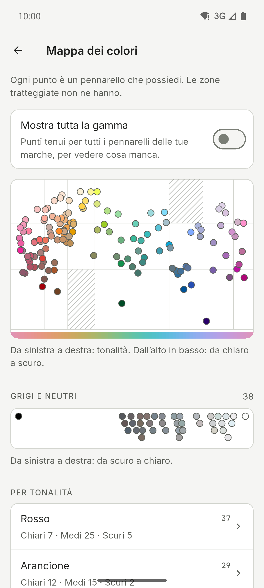

[English](README.md) · [Español](README.es.md) · [Deutsch](README.de.md) · [Français](README.fr.md) · [Português](README.pt.md) · **Italiano**

  

# Ink Lab

Un’app per chi disegna con pennarelli ad alcol, con campioni di colore e palette. Cerca
il codice di un colore, scopri quale pennarello della tua collezione si avvicina di più
a una foto e crea palette con la teoria del colore usando solo i pennarelli che hai. App
per Android, iPhone e iPad, con tema chiaro e scuro, layout per tablet e sei lingue.

**Gratis · Senza pubblicità · Senza account · Offline · Open source**

L’IA è facoltativa e disattivata di default.

## Download

  
  
  

iPhone e iPad sull’App Store. Android su GitHub e in test chiuso su Google Play.

Unisciti alla beta di Google Play

1. Iscriviti al gruppo [ink-lab-testers](https://groups.google.com/g/ink-lab-testers). Accedi a Google e premi «Partecipa al gruppo».
2. Accetta il test: [play.google.com/apps/testing/es.inklab.app](https://play.google.com/apps/testing/es.inklab.app).
3. Installa l’app da Google Play. Si aggiorna da sola.

Resta 14 giorni: Google richiede 12 tester per 14 giorni prima della
pubblicazione. Feedback: inklab@mainshai.com.

Installa l’APK da GitHub

1. Scarica l’APK e `SHA256SUMS.txt` dell’[ultima
   versione](https://github.com/dferrandizmont/ink-lab/releases/latest). Verifica il download con
   `sha256sum -c SHA256SUMS.txt`.
2. Consenti l’installazione da origini sconosciute quando il telefono lo chiede,
   poi apri l’APK.

## Schermate

  
  
  
  
  

Altre schermate

  
  
  
  
  

Tocca una schermata per ingrandirla.

## Funzioni

- **Quindici marche, 3.420 colori.** Ohuhu, DecoTime, Copic (Sketch, Ciao e Classic),
  Finecolour, Touch Twin, Promarker, Promarker Brush, Prismacolor Premier, Spectrum
  Noir, Arrtx, ZIG Kurecolor, Graph'it, Marvy Le Plume, Blick Studio Brush e Artist's
  Loft, con la ricerca delle marche e «In altre marche».
- **Dettaglio del pennarello.** Livello d’inchiostro e nota di ricarica, una foto del
  tuo campione reale, ombra e luce, «Sfuma con…» e avviso dei quasi doppioni.
- **Abbina.** Tocca un punto di una foto per trovare il pennarello della tua collezione
  più vicino, correggi il bianco e controlla i valori in grigio.
- **Palette e scene.** Armonie basate sulla teoria del colore, catene di sfumature e 67
  scene pronte, con la modalità cavalletto e palette da condividere o importare come
  testo.
- **Strumenti.** Una mappa dei colori della tua collezione, un traduttore di ricette di
  altre marche, le tue ricette di sfumatura con foto, e l’esportazione o l’importazione
  in CSV o testo.
- **Diario dei disegni.** Un registro di ciò che colori, con le sue foto, i pennarelli
  usati e i numeri che ci stanno dietro.
- **Backup.** Salva tutto in un file `.zip`, foto comprese; le Opzioni mostrano la data
  dell’ultimo.

Altre funzioni

- **Acquisti.** Una lista dei desideri, i pennarelli secchi e cosa comprare dopo.
- **Visione dei colori.** Guarda una palette come la vede chi ha un deficit di visione
  dei colori.
- **Cartella colori stampabile.** Pagine A4 con una casella etichettata per ogni
  pennarello che hai.
- **Idee.** Esercizi e tecniche con le loro palette, e le tue preferite.
- **Campioni e il tuo colore.** Codici, nomi e valori hex (un codice hex trova i
  pennarelli più vicini), più il colore che il pennarello dà davvero.
- **IA, se vuoi.** Suggerimenti di palette opzionali: Gemini Nano sul telefono o
  OpenRouter con la tua chiave.
- **Widget «Idea del giorno».** Solo su Android: l’esercizio di oggi, nei colori dei
  tuoi pennarelli, sulla schermata iniziale.
- **Scorciatoie.** Dall’icona dell’app ad Abbina, a una nuova palette o alla ricerca dei
  campioni.
- **Opzioni.** Licenze open source, «Invia un commento» e un registro degli errori
  locale da condividere o cancellare.

## Privacy

I tuoi dati restano sul telefono: nessun account, nessun server nostro, nessuna analisi,
nessuna pubblicità né tracciamento; senza l’IA la rete non viene mai usata. ML Kit
dell’IA sul dispositivo invia a Google dati diagnostici di utilizzo, mai richieste,
colori o foto. L’accesso a fotocamera e galleria serve solo per abbinare i colori,
creare scene, impostare il tuo colore e aggiungere foto al diario, ai tuoi campioni
reali e alle tue ricette di sfumatura; queste foto vengono elaborate sul dispositivo, e
quelle che conservi restano nella cartella privata dell’app e non vengono mai caricate.
Quando condividi una palette, una cartella colori o il backup `.zip`, il file va solo
all’app che scegli, e da nessun’altra parte.

[Sito](https://inklab.mainshai.com/it/) · [Informativa sulla privacy](https://inklab.mainshai.com/it/privacy/) ·
[Dettagli tecnici](docs/privacy.en.md) · Supporto: **inklab@mainshai.com**.

## Novità

La versione 1.2.3 mantiene i tuoi pennarelli dove sono: bloccare un colore non lo sposta più, aggiungere una famiglia non cancella più i pennarelli importati, senza pennarelli l’app lo dice invece di usare tutta la gamma, e puoi mescolare tutte le tue marche. La versione 1.2.2 corregge ciò che una revisione di tutte le schermate ha trovato: le palette salvate si aprono con un tocco, Indietro su Android torna ai Campioni e i testi sono più chiari. La versione 1.2.1 mostra per intero le descrizioni delle idee e corregge piccoli difetti di visualizzazione. La 1.2.0 ha portato 100 idee invece di 28, ordinate per difficoltà e per stagione per trovarle
facilmente, e un menu laterale più ordinato sui tablet. L’elenco completo è in
[CHANGELOG.md](CHANGELOG.md) e nelle
[versioni](https://github.com/dferrandizmont/ink-lab/releases).

## Contribuire

Segnalazioni di errori, idee e traduzioni sono benvenute. Come compilare, provare
e contribuire: [CONTRIBUTING.md](CONTRIBUTING.md).

## Licenza

Codice con licenza [MIT](LICENSE), Copyright (c) 2026 Daniel Mont Ferrandiz.
Documentazione e testi del progetto: [CC BY-SA 4.0](LICENSE-CONTENT.md). I dati dei
cataloghi sono riferimenti fattuali di terzi e restano fuori da entrambe le
licenze; i caratteri (SIL OFL 1.1) e gli altri materiali di terzi mantengono le
proprie condizioni.

Un progetto indipendente: **nessun legame con queste marche di pennarelli, né
sponsorizzazione o approvazione**. I nomi delle marche qui sopra sono marchi dei rispettivi proprietari.
Note complete: [NOTICE.md](NOTICE.md).

Per segnalare una vulnerabilità: [SECURITY.md](SECURITY.md).
