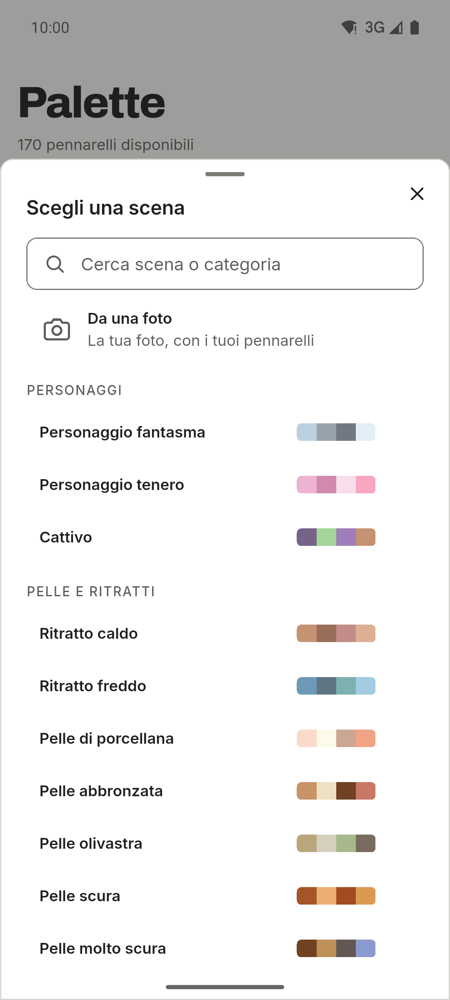
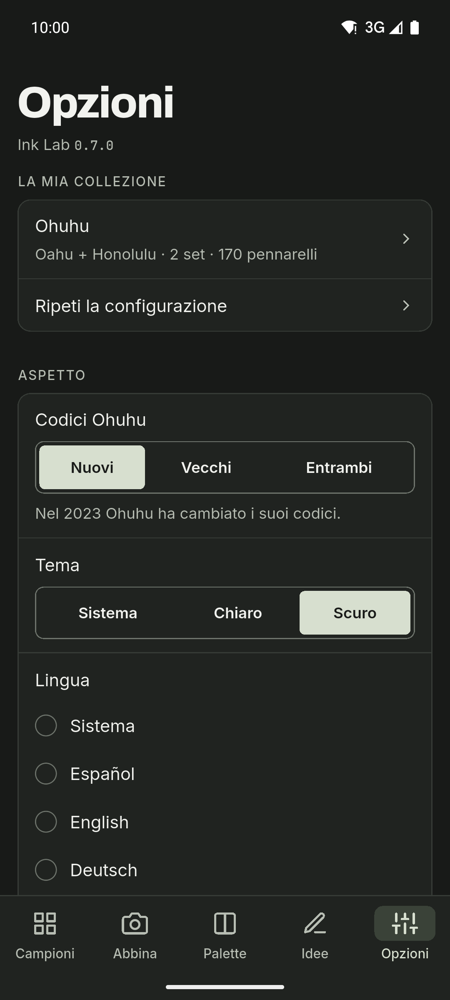

[English](README.md) · [Español](README.es.md) · [Deutsch](README.de.md) · [Français](README.fr.md) · [Português](README.pt.md) · **Italiano**

  

# Ink Lab

Un’app per chi disegna con pennarelli ad alcol, con campioni di colore e palette.
Cerca il codice di un colore, scopri quale pennarello della tua collezione si
avvicina di più a una foto e crea palette con la teoria del colore usando solo i
pennarelli che hai. App per Android, con tema chiaro e scuro, barra laterale sui
tablet e sei lingue.

**Gratis · Senza pubblicità · Senza account · Offline · Open source**

L’IA è facoltativa e disattivata di default.

## Download

  
  
  <!--
  
  -->

Android su GitHub e in test chiuso su Google Play. iOS arriverà più avanti.

Unisciti alla beta di Google Play

Chiunque può entrare nel test chiuso:

1. Iscriviti al gruppo [ink-lab-testers](https://groups.google.com/g/ink-lab-testers). Accedi a Google e premi «Partecipa al gruppo».
2. Accetta il test: [play.google.com/apps/testing/es.inklab.app](https://play.google.com/apps/testing/es.inklab.app).
3. Installa l’app da Google Play. Si aggiorna da sola.

Resta 14 giorni: Google richiede 12 tester per 14 giorni prima della
pubblicazione. Feedback: inklab@mainshai.com.

Installa l’APK da GitHub

1. Scarica l’APK e `SHA256SUMS.txt` dell’[ultima
   versione](https://github.com/dferrandizmont/ink-lab/releases/latest). Verifica il download con
   `sha256sum -c SHA256SUMS.txt`.
2. Consenti l’installazione da origini sconosciute quando il telefono lo chiede,
   poi apri l’APK.

## Schermate

  
  
  
  
  

Altre schermate

  
  
  

Tocca una schermata per ingrandirla.

## Funzioni

- **I miei pennarelli.** Una guida iniziale costruisce la collezione di ogni
  marca con le tue serie, i set e i pennarelli singoli.
- **Abbinamento da una foto.** Tocca un punto per trovare il pennarello più
  vicino; correggi il bianco perché i colori campionati siano fedeli.
- **Il tuo colore.** Il colore del catalogo è una stima; imposta quello che il
  pennarello dà davvero, con l’hex o una foto.
- **Palette e catene di sfumature.** Armonie basate sulla teoria del colore e
  catene di sfumature di tre-cinque pennarelli, dal più chiaro al più scuro.
- **Scene.** 67 ricette in 11 categorie, ognuna con i suoi ruoli di colore.
- **Diario dei disegni.** Un registro di ciò che colori: data, carta, pennarelli,
  note e fino a quattro foto.
- **Tre marche.** Ohuhu (503 colori), DecoTime (313) e Copic (358), con
  selezione individuale dei pennarelli.

Altre funzioni

- **Campioni.** Codici, nomi e valori hex, con ricerca, filtri e preferiti.
- **Scena da una foto.** Trasforma i colori principali di una foto nei tuoi
  pennarelli più vicini.
- **Condividi e stampa.** Condividi una palette come immagine o crea una cartella
  colori A4 stampabile.
- **Lista dei desideri e pennarelli secchi.** Annota i pennarelli che vuoi
  comprare e segna quelli esauriti come secchi, così l’app li salta.
- **Idee e IA.** Sfide e tecniche, più Gemini Nano opzionale sui dispositivi
  Android compatibili o OpenRouter con la tua chiave API.
- **Backup.** Esporta e importa i tuoi dati come testo JSON, senza le foto.

## Privacy

I tuoi dati restano sul telefono: nessun account, nessun server nostro, nessuna
analisi dell’utilizzo da parte dello sviluppatore, nessuna pubblicità né
tracciamento; senza l’IA la rete non viene mai usata. ML Kit dell’IA sul
dispositivo invia a Google dati diagnostici di utilizzo, mai richieste, colori o
foto. L’accesso a fotocamera e galleria serve solo per abbinare i colori, creare
scene, impostare il tuo colore e aggiungere foto al diario; le foto di
abbinamento e scene vengono elaborate sul dispositivo, e quelle del diario
restano nella cartella privata dell’app e non vengono mai caricate. Quando
condividi una palette o una cartella colori, l’immagine va solo all’app che
scegli.

[Sito](https://inklab.mainshai.com/it/) · [Informativa sulla privacy](https://inklab.mainshai.com/it/privacy/) ·
[Dettagli tecnici](docs/privacy.en.md) · Supporto: **inklab@mainshai.com**.

## Novità

La 0.7.0 aggiunge il diario dei disegni, le catene di sfumature, i tuoi colori
con la correzione del bianco, la lista dei desideri, i pennarelli secchi, le
cartelle colori stampabili e la condivisione. L’elenco completo è in [CHANGELOG.md](CHANGELOG.md).

## Contribuire

Segnalazioni di errori, idee e traduzioni sono benvenute. Come compilare, provare
e contribuire: [CONTRIBUTING.md](CONTRIBUTING.md).

## Licenza

Codice con licenza [MIT](LICENSE), Copyright (c) 2026 Daniel Mont Ferrandiz.
Documentazione e testi del progetto: [CC BY-SA 4.0](LICENSE-CONTENT.md). I dati dei
cataloghi sono riferimenti fattuali di terzi e restano fuori da entrambe le
licenze; i caratteri (SIL OFL 1.1) e gli altri materiali di terzi mantengono le
proprie condizioni, elencate in [NOTICE.md](NOTICE.md).

Un progetto indipendente: **nessun legame con Ohuhu, DecoTime o Copic, né
sponsorizzazione o approvazione**. «Ohuhu», «Oahu», «DecoTime» e «Copic» sono marchi dei rispettivi proprietari.
Le fonti e le note complete sono in [NOTICE.md](NOTICE.md).

Per segnalare una vulnerabilità: [SECURITY.md](SECURITY.md).
