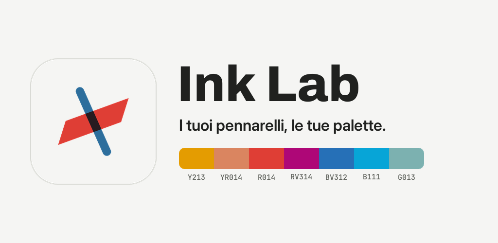
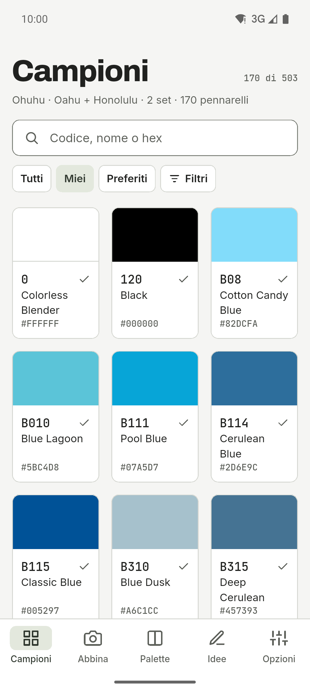
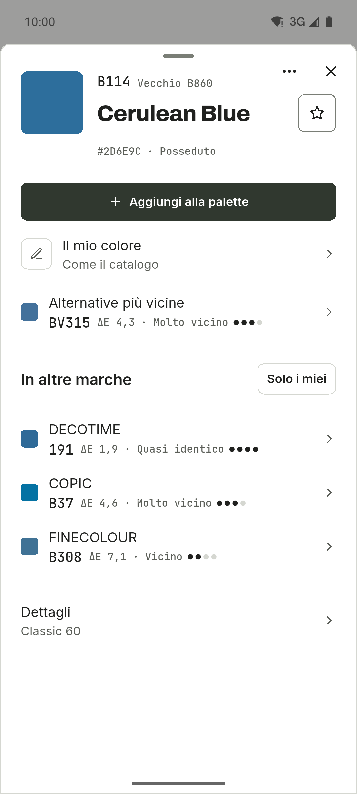
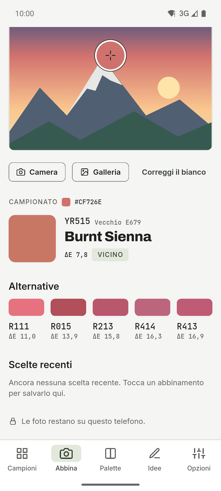
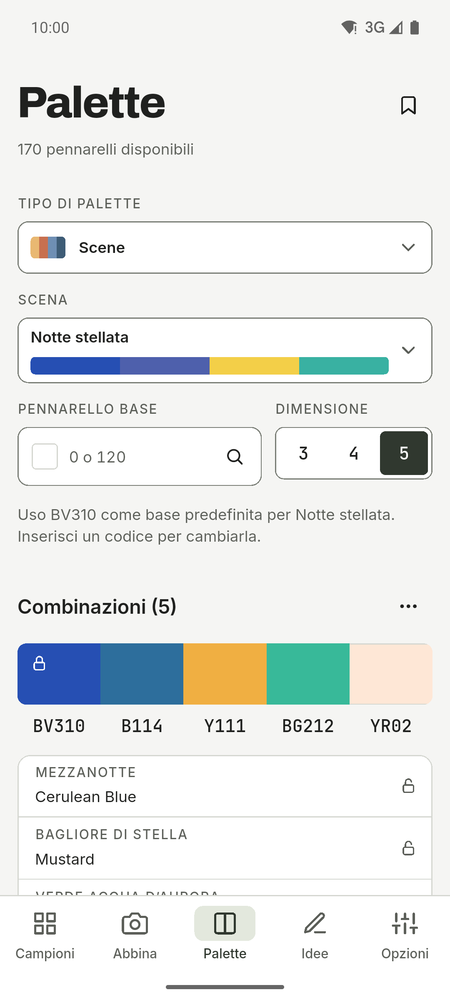
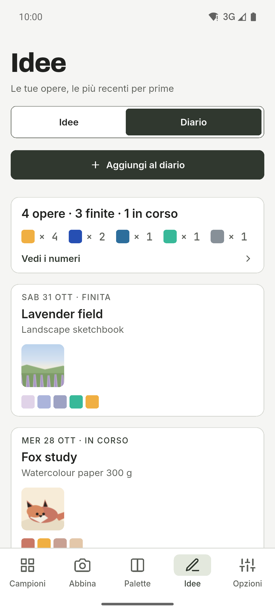
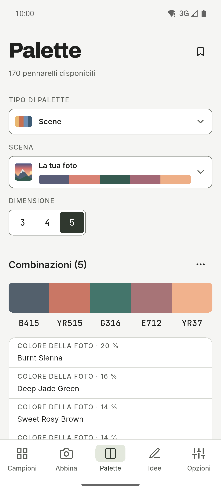
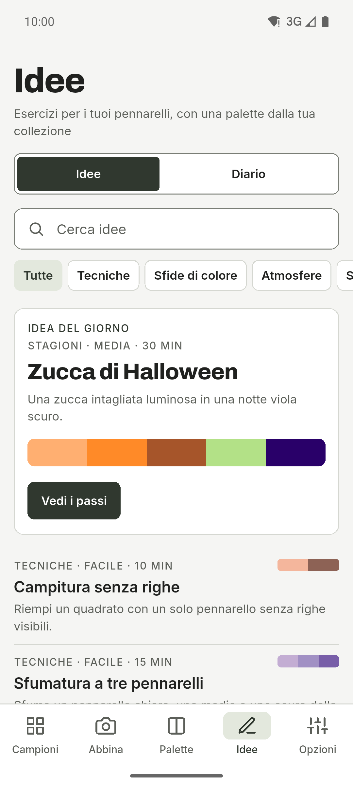
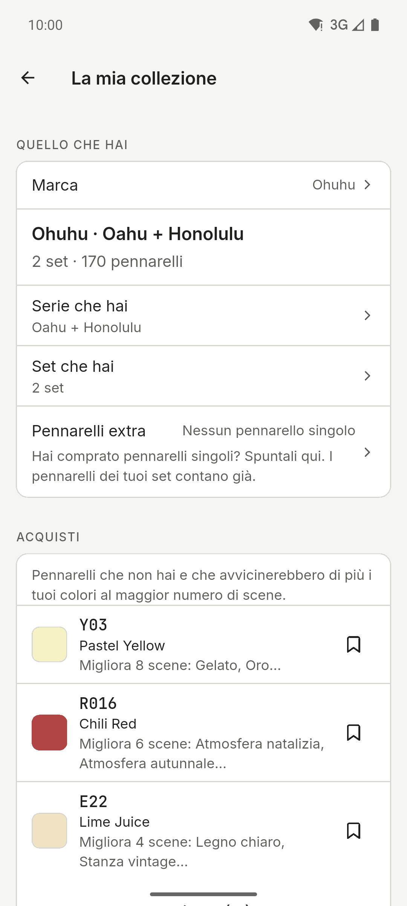
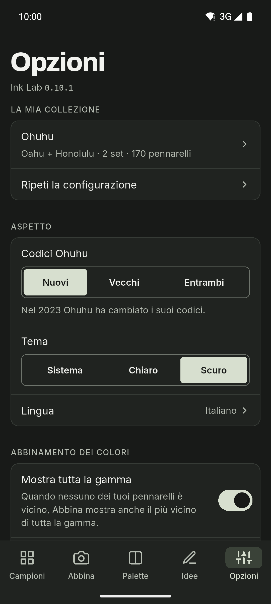

[English](README.md) · [Español](README.es.md) · [Deutsch](README.de.md) · [Français](README.fr.md) · [Português](README.pt.md) · **Italiano**

  

# Ink Lab

Un’app per chi disegna con pennarelli ad alcol, con campioni di colore e palette.
Cerca il codice di un colore, scopri quale pennarello della tua collezione si
avvicina di più a una foto e crea palette con la teoria del colore usando solo i
pennarelli che hai. App per Android, con tema chiaro e scuro, barra laterale sui
tablet e sei lingue.

**Gratis · Senza pubblicità · Senza account · Offline · Open source**

L’IA è facoltativa e disattivata di default.

## Download

  
  
  

iPhone sull’App Store. Android su GitHub e in test chiuso su Google Play.

Unisciti alla beta di Google Play

1. Iscriviti al gruppo [ink-lab-testers](https://groups.google.com/g/ink-lab-testers). Accedi a Google e premi «Partecipa al gruppo».
2. Accetta il test: [play.google.com/apps/testing/es.inklab.app](https://play.google.com/apps/testing/es.inklab.app).
3. Installa l’app da Google Play. Si aggiorna da sola.

Resta 14 giorni: Google richiede 12 tester per 14 giorni prima della
pubblicazione. Feedback: inklab@mainshai.com.

Installa l’APK da GitHub

1. Scarica l’APK e `SHA256SUMS.txt` dell’[ultima
   versione](https://github.com/dferrandizmont/ink-lab/releases/latest). Verifica il download con
   `sha256sum -c SHA256SUMS.txt`.
2. Consenti l’installazione da origini sconosciute quando il telefono lo chiede,
   poi apri l’APK.

## Schermate

  
  
  
  
  

Altre schermate

  
  
  
  

Tocca una schermata per ingrandirla.

## Funzioni

- **Diario dei disegni.** Un registro di ciò che colori, con le sue foto, i
  pennarelli usati e i numeri che ci stanno dietro.
- **Quattro marche.** Ohuhu (503 colori), DecoTime (313), Copic (358) e Finecolour
  (480), con il pennarello più vicino di ogni altra marca in «In altre marche».
- **Abbina.** Tocca un punto di una foto per trovare il pennarello della tua
  collezione più vicino, e correggi il bianco.
- **Palette e scene.** Armonie basate sulla teoria del colore, catene di sfumature
  e 67 scene pronte in 11 categorie.
- **Backup.** Salva tutto in un file `.zip`, con dentro le foto del diario.
- **Acquisti.** Una lista dei desideri, i pennarelli secchi e cosa comprare dopo.

Altre funzioni

- **Visione dei colori.** Guarda un’anteprima di una palette come la vede chi ha
  protanopia, deuteranopia, tritanopia o acromatopsia.
- **Cartella colori stampabile.** Pagine A4 con una casella etichettata per ogni
  pennarello che hai.
- **Idee.** Esercizi e tecniche con le loro palette, e le tue preferite.
- **Campioni e il tuo colore.** Codici, nomi e valori hex, più il colore che il
  pennarello dà davvero.
- **Condividi.** Invia una palette, una cartella colori o una voce del diario a
  un’altra app come immagine.
- **IA, se vuoi.** Suggerimenti di palette opzionali: Gemini Nano sul telefono o
  OpenRouter con la tua chiave.
- **Widget «Idea del giorno».** Un widget Android per la schermata iniziale con
  l’esercizio di oggi, nei colori dei tuoi pennarelli. Cambia da solo ogni giorno
  e un tocco apre l’idea.

## Privacy

I tuoi dati restano sul telefono: nessun account, nessun server nostro, nessuna
analisi, nessuna pubblicità né tracciamento; senza l’IA la rete non viene mai
usata. ML Kit dell’IA sul dispositivo invia a Google dati diagnostici di utilizzo,
mai richieste, colori o foto. L’accesso a fotocamera e galleria serve solo per
abbinare i colori, creare scene, impostare il tuo colore e aggiungere foto al
diario; queste foto vengono elaborate sul dispositivo, e quelle del diario
restano nella cartella privata dell’app e non vengono mai caricate. Quando
condividi una palette, una cartella colori o il backup `.zip`, il file va solo
all’app che scegli, e da nessun’altra parte.

[Sito](https://inklab.mainshai.com/it/) · [Informativa sulla privacy](https://inklab.mainshai.com/it/privacy/) ·
[Dettagli tecnici](docs/privacy.en.md) · Supporto: **inklab@mainshai.com**.

## Novità

La versione 0.10.0 è uscita. Novità: un widget Android per la schermata iniziale
con l’idea del giorno, nei colori dei tuoi pennarelli. La serie 0.9 ha messo in
ordine l’app. L’elenco completo è in [CHANGELOG.md](CHANGELOG.md) e nelle
[versioni](https://github.com/dferrandizmont/ink-lab/releases).

## Contribuire

Segnalazioni di errori, idee e traduzioni sono benvenute. Come compilare, provare
e contribuire: [CONTRIBUTING.md](CONTRIBUTING.md).

## Licenza

Codice con licenza [MIT](LICENSE), Copyright (c) 2026 Daniel Mont Ferrandiz.
Documentazione e testi del progetto: [CC BY-SA 4.0](LICENSE-CONTENT.md). I dati dei
cataloghi sono riferimenti fattuali di terzi e restano fuori da entrambe le
licenze; i caratteri (SIL OFL 1.1) e gli altri materiali di terzi mantengono le
proprie condizioni.

Un progetto indipendente: **nessun legame con Ohuhu, DecoTime, Copic o Finecolour, né
sponsorizzazione o approvazione**. « Ohuhu », « Oahu », « DecoTime », « Copic » e « Finecolour » sono marchi dei rispettivi proprietari.
Note complete: [NOTICE.md](NOTICE.md).

Per segnalare una vulnerabilità: [SECURITY.md](SECURITY.md).
