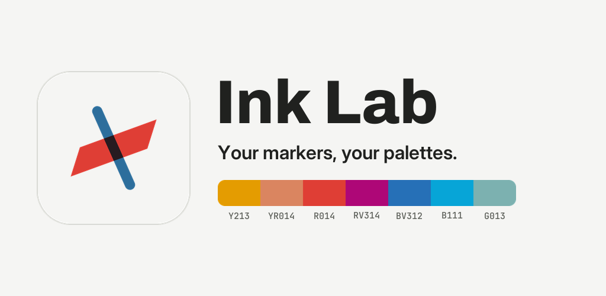
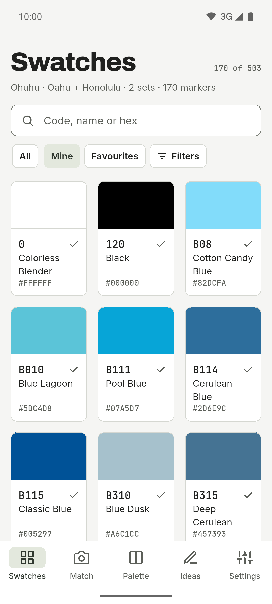
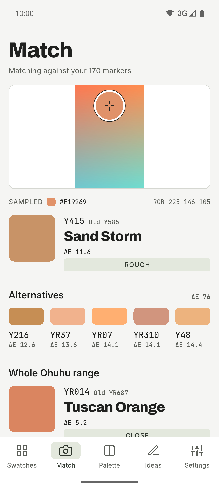
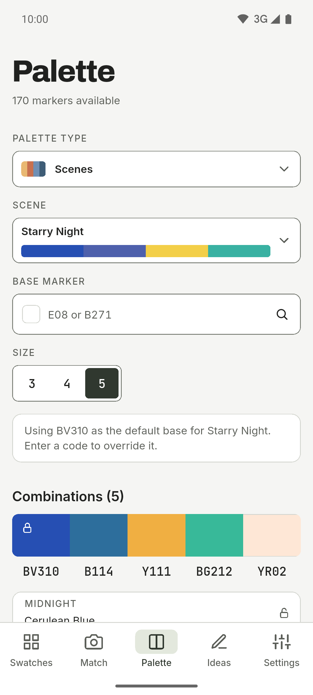
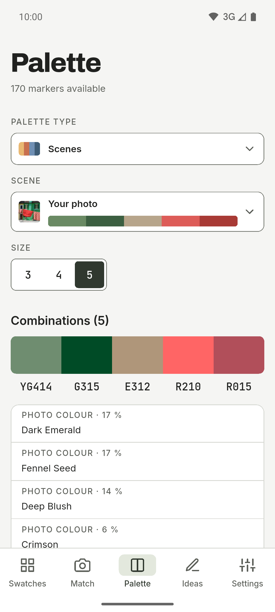
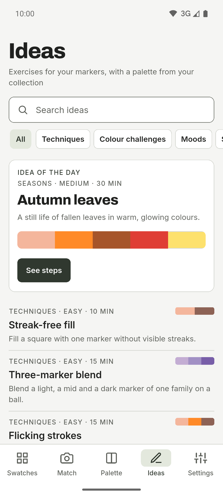
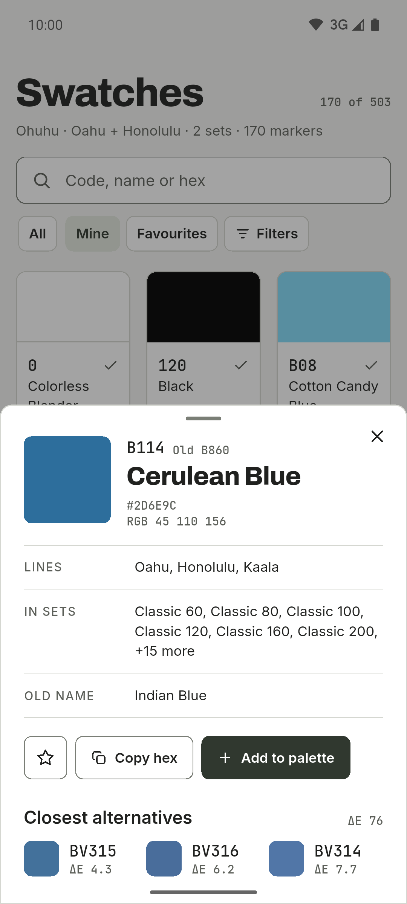
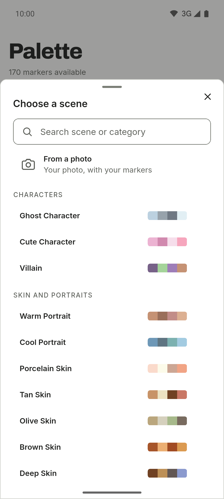
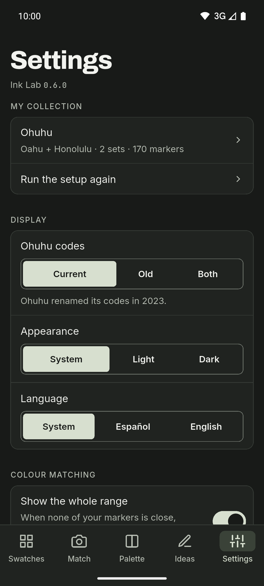

**English** · [Español](README.es.md)

  

# Ink Lab

A swatch and palette companion for people who draw with alcohol markers. Look up
the code of a colour, find out which marker in your collection is closest to a
photo, and build palettes with colour theory using only the markers you own.
For Android, with light and dark themes, a side rail on tablets and Spanish and
English texts.

**Free · No ads · No account · Works offline · Open source**

AI is optional and off by default.

## Download

  
  <!--
  
  
  -->

Android on GitHub, and in closed testing on Google Play. iOS is coming.

Join the beta on Google Play

Ink Lab is in closed testing on Google Play before its public launch, and testers are welcome:

1. Join the [ink-lab-testers](https://groups.google.com/g/ink-lab-testers) Google Group
   (`ink-lab-testers@googlegroups.com`) with the Google account you use on Google Play.
2. Open the [testing invitation](https://play.google.com/apps/testing/es.inklab.app), accept it and install
   Ink Lab from Google Play. The invitation works once the test is live; if it says the app isn't
   available, try again in a few days.
3. Keep it installed for at least 14 days. Send what you find to dev@mainshai.com.

Install the APK from GitHub

1. Download the APK and `SHA256SUMS.txt` of the [latest
   release](https://github.com/dferrandizmont/ink-lab/releases/latest). Every
   release ships both, so you can verify the download with
   `sha256sum -c SHA256SUMS.txt`.
2. Allow installing apps from unknown sources when your phone asks, then open
   the APK.

## Screenshots

  
  
  
  
  

More screenshots

  
  
  

Tap a screenshot to enlarge it.

## Features

- **My markers.** One collection per brand, built from the series you use, the
  sets you own and any loose markers. A short first-run guide sets it up.
- **Swatches.** The catalogue by code and name, with the hex of each marker,
  search, filters, your own markers and favourites. On Ohuhu Oahu it also shows where each
  marker sits on the colour card.
- **Match from a photo.** Take a photo or pick one from the gallery, tap a point
  and the app tells you which marker in your collection is closest, or says so
  when none is close.
- **Colour-theory palettes.** Pick a base colour and get harmonies
  (complementary, analogous, split complementary, triad, square, rectangle,
  monochrome and shadow), always resolved with the markers you own.
- **Scenes.** 67 ready-made recipes in 11 categories (skin, sky and water,
  nature, animals, food, fantasy…), searchable, each with its colour roles.
- **Scene from a photo.** The app finds the main colours of a photo and turns
  them into the closest markers you own.
- **Two brands.** Ohuhu (Oahu, Honolulu and Kaala, 503 colours, with the new
  and legacy codes) and DecoTime (313 colours, with an owned-markers
  selection, as it is sold in fixed sets).

More features

- **Ideas.** Challenges and techniques with a palette from your active
  collection.
- **Optional AI.** Either **on the device** (Gemini Nano, on compatible Android
  phones, through Google's ML Kit, which sends Google usage diagnostics but never
  your prompts, colours or photos) or with **your own OpenRouter key**. If you
  do not turn it on, the app never uses the network.
- **Backup.** Export and import your collections, favourites, palettes and
  settings as JSON text, with no account.

## Privacy

Everything is stored on the phone. There are no accounts, no server of ours, no
analytics of ours, no ads and no tracking. If you do not turn on AI, the app
never uses the network. On-device AI uses Google's ML Kit, which sends Google
usage diagnostics, never your prompts, colours or photos. The camera and the
gallery are only used to match a photo or to make a scene from one, and the
photo never leaves the device.

[Privacy policy](https://dferrandizmont.github.io/ink-lab/privacidad/en/) ·
[Technical details](docs/privacy.en.md) · Support: **dev@mainshai.com**.

## What's new

See [CHANGELOG.md](CHANGELOG.md).

## Contributing

Bug reports, ideas and translations are welcome. How to build, test and
contribute: [CONTRIBUTING.md](CONTRIBUTING.md).

## License

Code under [MIT](LICENSE), Copyright (c) 2026 Daniel Mont Ferrandiz. Own
documentation and texts: [CC BY-SA 4.0](LICENSE-CONTENT.md). The catalogue
data are third-party factual references and fall outside both MIT and CC BY-SA
4.0; the typefaces (SIL OFL 1.1) and other third-party material keep their own
licences, listed in [NOTICE.md](NOTICE.md).

An independent project: **not affiliated with, sponsored by or endorsed by Ohuhu
or DecoTime**. "Ohuhu", "Oahu" and "DecoTime" are trademarks of their owners.
Sources and full notices are in [NOTICE.md](NOTICE.md).

To report a vulnerability: [SECURITY.md](SECURITY.md).
