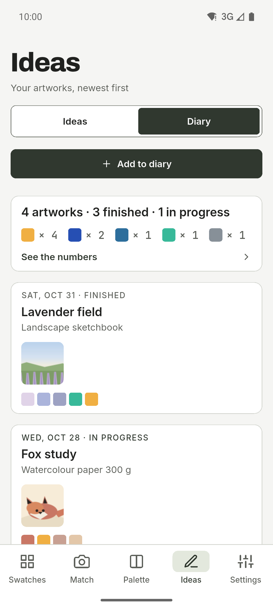
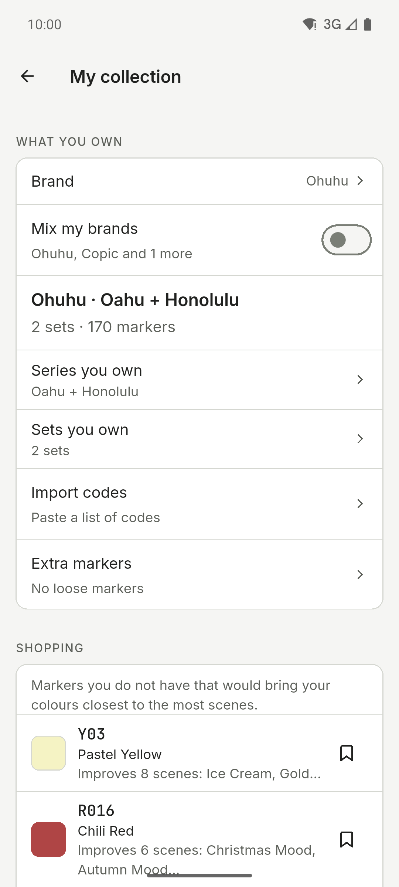
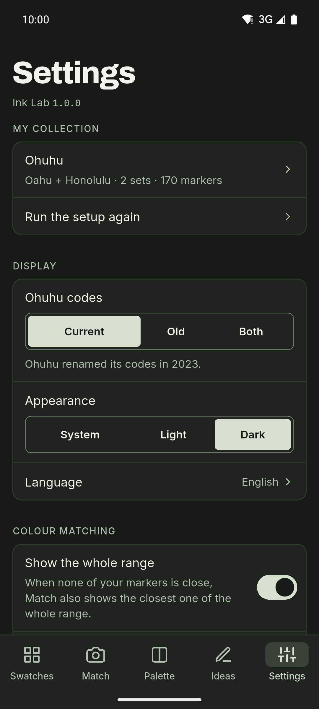
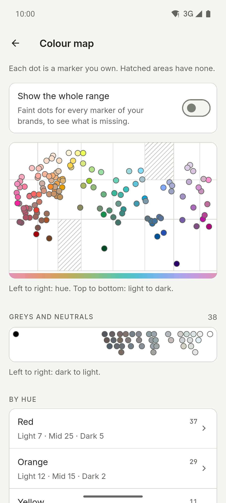

**English** · [Español](README.es.md) · [Deutsch](README.de.md) · [Français](README.fr.md) · [Português](README.pt.md) · [Italiano](README.it.md)

  

# Ink Lab

A swatch and palette companion for people who draw with alcohol markers. Look up a
colour code, match a photo to your markers and build colour-theory palettes with them.
App for Android, iPhone and iPad, with light and dark themes, tablet layouts and six
languages.

**Free · No ads · No account · Works offline · Open source**

AI is optional and off by default.

## Download

  
  
  

iPhone and iPad on the App Store. Android on GitHub, and in closed testing on Google Play.

Join the beta on Google Play

1. Join [ink-lab-testers](https://groups.google.com/g/ink-lab-testers). Sign in to Google and press «Join group».
2. Accept the test: [play.google.com/apps/testing/es.inklab.app](https://play.google.com/apps/testing/es.inklab.app).
3. Install the app from Google Play. It updates itself.

Stay 14 days: Google requires 12 testers for 14 days before release. Feedback:
inklab@mainshai.com.

Install the APK from GitHub

1. Download the APK and `SHA256SUMS.txt` of the [latest
   release](https://github.com/dferrandizmont/ink-lab/releases/latest). Verify with
   `sha256sum -c SHA256SUMS.txt`.
2. Allow installing apps from unknown sources when asked, then open the APK.

## Screenshots

  
  
  
  
  

More screenshots

  
  
  
  
  

Tap a screenshot to enlarge it.

## Features

- **Fifteen brands, 3,420 colours.** Ohuhu, DecoTime, Copic (Sketch, Ciao and Classic),
  Finecolour, Touch Twin, Promarker, Promarker Brush, Prismacolor Premier, Spectrum
  Noir, Arrtx, ZIG Kurecolor, Graph'it, Marvy Le Plume, Blick Studio Brush and Artist's
  Loft, with a brand search and «In other brands».
- **Marker detail.** Ink level and a refill note, a photo of your real swatch, shadow
  and light, «Blend with…» and a near-duplicate warning.
- **Match.** Tap a point in a photo to find your closest marker, fix the white balance
  and check the values in grey.
- **Palettes and scenes.** Colour-theory harmonies, blending chains and 67 ready-made
  scenes, with easel mode and palettes you can share or import as text.
- **Tools.** A colour map of your collection, a translator for recipes from other
  brands, your own blending recipes with a photo, and export or import as CSV or text.
- **Artwork diary.** A log of what you paint, with photos, the markers you used and the
  numbers behind it.
- **Backup.** Save everything in a `.zip` file, photos included; Settings shows your
  last backup date.

More features

- **Shopping.** A wishlist, the markers that dried out, and what to buy next.
- **Colour vision.** Preview a palette as someone with colour blindness sees it.
- **Printable swatch chart.** A4 pages with a labelled box for each marker you own.
- **Ideas.** Exercises and techniques with their own palettes, and your favourites.
- **Swatches and your own colours.** Codes, names and hex values (a hex code finds the
  nearest markers), plus your marker’s real colour.
- **AI, if you want it.** Optional palette suggestions: Gemini Nano on the phone or
  OpenRouter with your key.
- **Idea of the day widget.** Android only: today’s exercise in your marker colours, on
  the home screen.
- **Shortcuts.** Quick actions on the app icon for Match, a new palette and the swatch
  search.
- **Settings.** Open-source licences, «Send feedback» and a local error log you can
  share or clear.

## Privacy

Data stays on your phone: no accounts, no server, no analytics, no ads or tracking, and
without AI no network use. On-device AI’s ML Kit sends Google usage diagnostics, never
prompts, colours or photos. Camera and gallery access is only for photo matching,
scenes, your own colours, the diary, real swatches and blending recipes; those photos
are processed on the device, and the ones you keep stay in the app’s private folder.
Sharing a palette, a chart or the `.zip` backup hands the file to the app you pick.

[Website](https://inklab.mainshai.com) · [Privacy policy](https://inklab.mainshai.com/privacy/) ·
[Technical details](docs/privacy.en.md) · Support: **inklab@mainshai.com**.

## What's new

Version 1.2.5 keeps a palette of a brand you are not using when you regenerate it, shows brand and code whole with mixed brands and large text, and shows one notice per variation. Version 1.2.4 keeps the palette on screen when you change the brand, and tidies up Palette on tablets. Version 1.2.3 keeps your markers where they are: locking a colour no longer moves it, adding a family no longer wipes imported markers, with no markers the app says so instead of using the whole range, and you can mix all your brands. Version 1.2.2 fixes what a full review of every screen found: saved palettes open with a tap, Back on Android returns to Swatches, and texts are clearer. Version 1.2.1 shows idea descriptions in full and fixes a few small display issues. Version 1.2.0 brought 100 ideas instead of 28, grouped by difficulty and by season so they are easy to
browse, and a tidier side menu on tablets. Full list in [CHANGELOG.md](CHANGELOG.md) and in the
[releases](https://github.com/dferrandizmont/ink-lab/releases).

## Contributing

Bug reports, ideas and translations are welcome. How to build and contribute:
[CONTRIBUTING.md](CONTRIBUTING.md).

## License

Code under [MIT](LICENSE), Copyright (c) 2026 Daniel Mont Ferrandiz. Own
documentation and texts: [CC BY-SA 4.0](LICENSE-CONTENT.md). Catalogue data are
third-party references outside both licences; the typefaces (SIL OFL 1.1) and
other third-party material keep their own terms.

An independent project: **not affiliated with, sponsored by or endorsed by any of
these marker brands**. The names of the brands above are trademarks of their respective owners.
Full notices: [NOTICE.md](NOTICE.md).

To report a vulnerability: [SECURITY.md](SECURITY.md).
