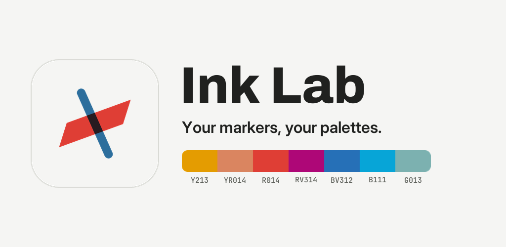
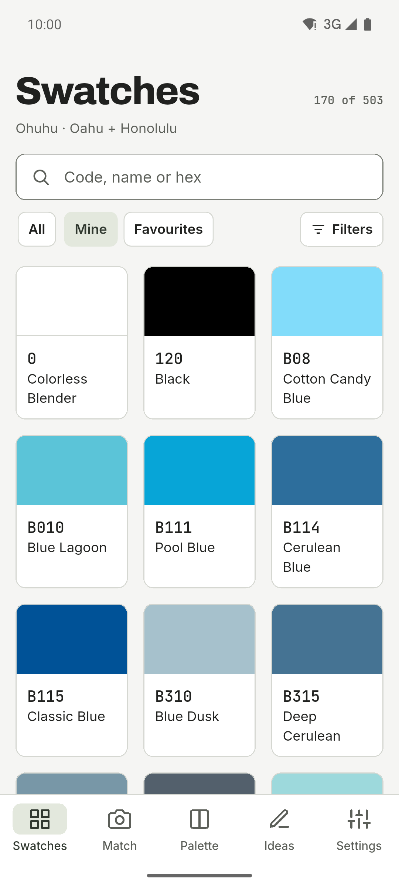
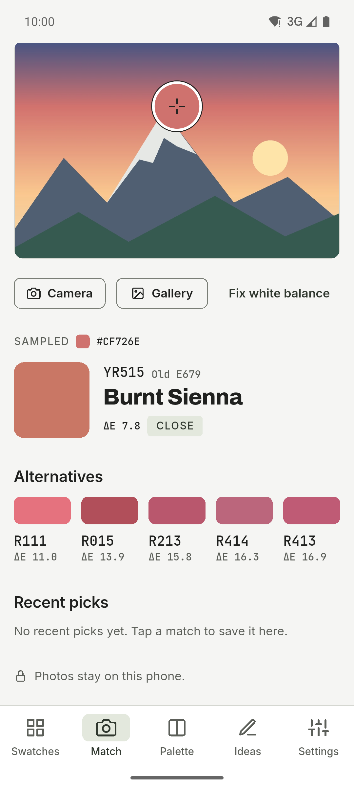
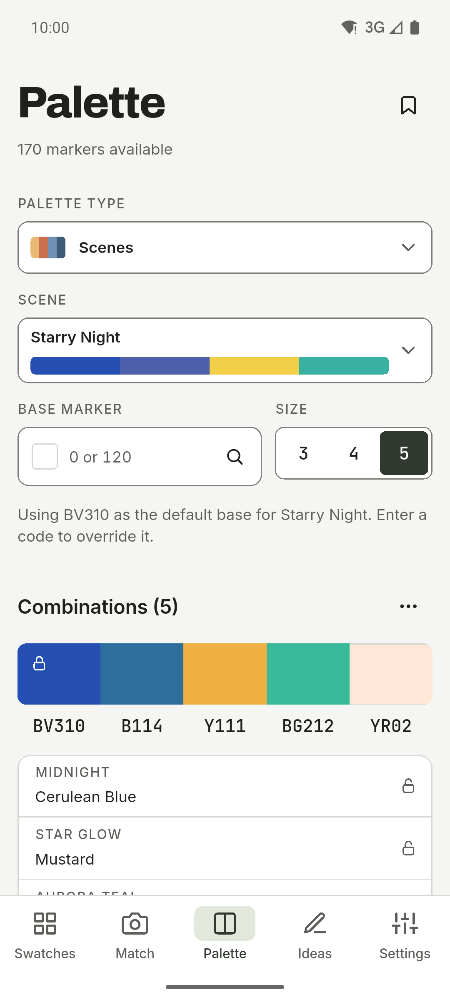
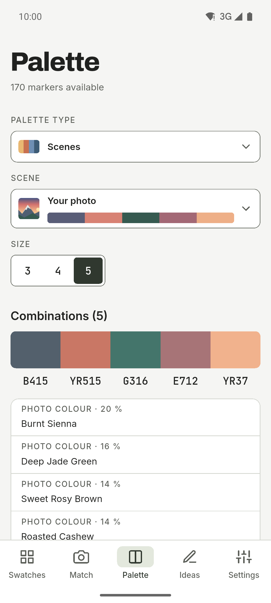
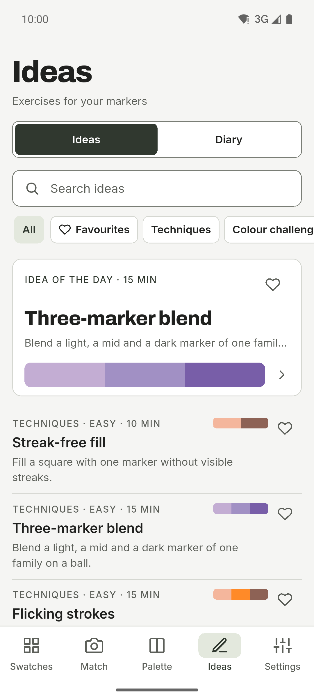
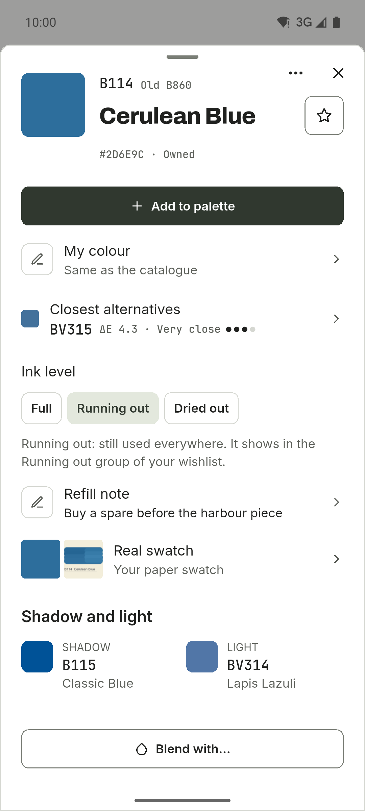
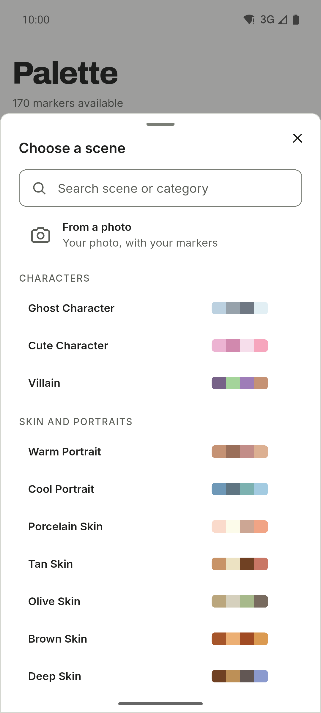
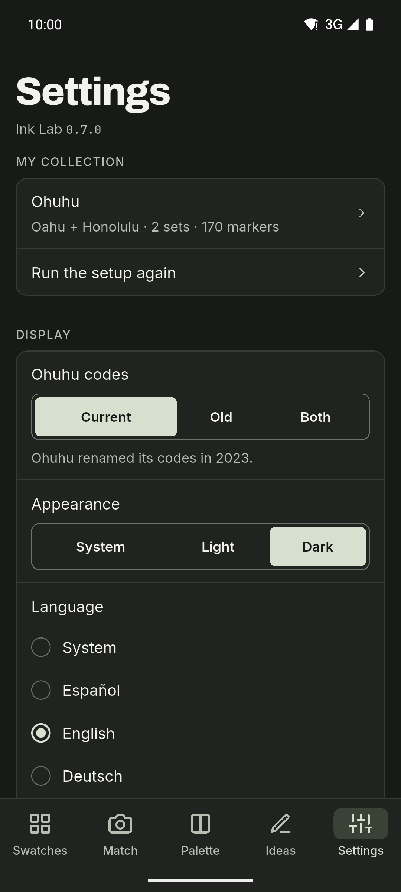

**English** · [Español](README.es.md) · [Deutsch](README.de.md) · [Français](README.fr.md) · [Português](README.pt.md) · [Italiano](README.it.md)

  

# Ink Lab

A swatch and palette companion for people who draw with alcohol markers. Look up
a colour code, find the marker you own closest to a photo and build colour-theory
palettes with only your markers. Android app with light and dark themes, a tablet
side rail and six languages.

**Free · No ads · No account · Works offline · Open source**

AI is optional and off by default.

## Download

  
  
  <!--
  
  -->

Android on GitHub, and in closed testing on Google Play. iOS is coming.

Join the beta on Google Play

Anyone can join the closed test:

1. Join [ink-lab-testers](https://groups.google.com/g/ink-lab-testers). Sign in to Google and press «Join group».
2. Accept the test: [play.google.com/apps/testing/es.inklab.app](https://play.google.com/apps/testing/es.inklab.app).
3. Install the app from Google Play. It updates itself.

Stay for 14 days: Google requires 12 testers for 14 days before public release.
Feedback: inklab@mainshai.com.

Install the APK from GitHub

1. Download the APK and `SHA256SUMS.txt` of the [latest
   release](https://github.com/dferrandizmont/ink-lab/releases/latest). Verify with
   `sha256sum -c SHA256SUMS.txt`.
2. Allow installing apps from unknown sources when your phone asks, then open
   the APK.

## Screenshots

  
  
  
  
  

More screenshots

  
  
  

Tap a screenshot to enlarge it.

## Features

- **My markers.** A first-run guide builds each brand’s collection from your
  series, sets and loose markers.
- **Match from a photo.** Tap a point to find your closest marker; fix the white
  balance so the colours you sample are true.
- **Your own colour.** The catalogue colour is an estimate; set the colour your
  marker really gives, by hex or a photo.
- **Palettes and blending chains.** Colour-theory harmonies, and blending chains
  of three to five markers, lightest first.
- **Scenes.** 67 recipes across 11 categories, each with its colour roles.
- **Artwork diary.** A log of what you paint: date, paper, markers, notes and up
  to four photos.
- **Four brands.** Ohuhu (503 colours), DecoTime (313), Copic (358) and Finecolour (480), with
  individual marker selection.

More features

- **Swatches.** Codes, names and hex values, with search, filters and favourites.
- **Scene from a photo.** Turn a photo’s main colours into your markers.
- **Share and print.** Share a palette as an image, or make a printable A4
  swatch chart.
- **Wishlist and dried markers.** Keep the markers to buy, and mark worn-out
  ones as dried so the app skips them.
- **Ideas and AI.** Challenges and techniques, plus optional Gemini Nano on
  compatible Android devices or OpenRouter with your own API key.
- **Backup.** Export and import your data as JSON text, without photos.

## Privacy

Data stays on your phone: no accounts, no server of ours, no analytics of ours,
no ads or tracking, and without AI no network use. On-device AI’s ML Kit sends
Google usage diagnostics, never prompts, colours or photos. Camera and gallery
access is only for photo matching, scenes, your own marker colours and the
diary; match and scene photos are processed on the device, and diary photos stay
in the app’s private folder, never uploaded. Sharing a palette or a chart only
hands it to the app you pick.

[Website](https://inklab.mainshai.com) · [Privacy policy](https://inklab.mainshai.com/privacy/) ·
[Technical details](docs/privacy.en.md) · Support: **inklab@mainshai.com**.

## What's new

0.7.0 adds the artwork diary, blending chains, your own colours with the
white-balance fix, the wishlist, dried markers, printable swatch charts and
sharing. Full list in [CHANGELOG.md](CHANGELOG.md).

## Contributing

Bug reports, ideas and translations are welcome. How to build, test and
contribute: [CONTRIBUTING.md](CONTRIBUTING.md).

## License

Code under [MIT](LICENSE), Copyright (c) 2026 Daniel Mont Ferrandiz. Own
documentation and texts: [CC BY-SA 4.0](LICENSE-CONTENT.md). The catalogue data
are third-party factual references outside both licences; the typefaces (SIL
OFL 1.1) and other third-party material keep their own terms, listed in
[NOTICE.md](NOTICE.md).

An independent project: **not affiliated with, sponsored by or endorsed by Ohuhu,
DecoTime, Copic or Finecolour**. "Ohuhu", "Oahu", "DecoTime", "Copic" and "Finecolour" are trademarks of their owners.
Sources and full notices are in [NOTICE.md](NOTICE.md).

To report a vulnerability: [SECURITY.md](SECURITY.md).
