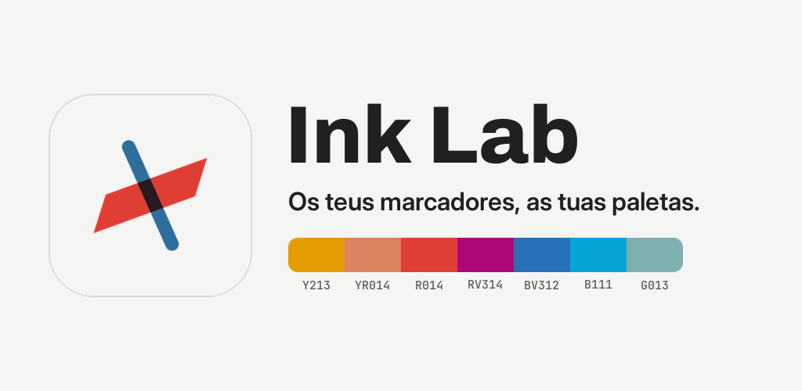
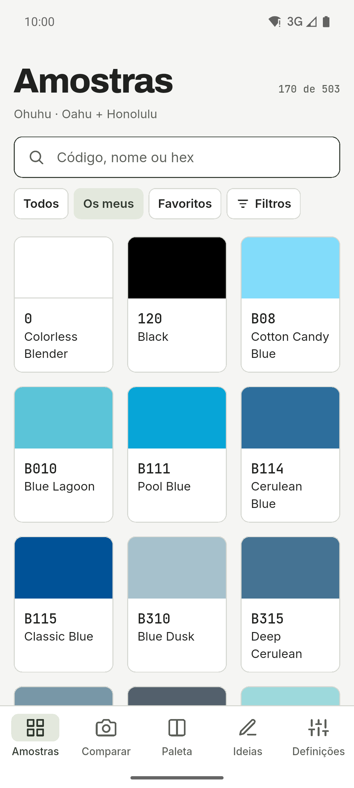
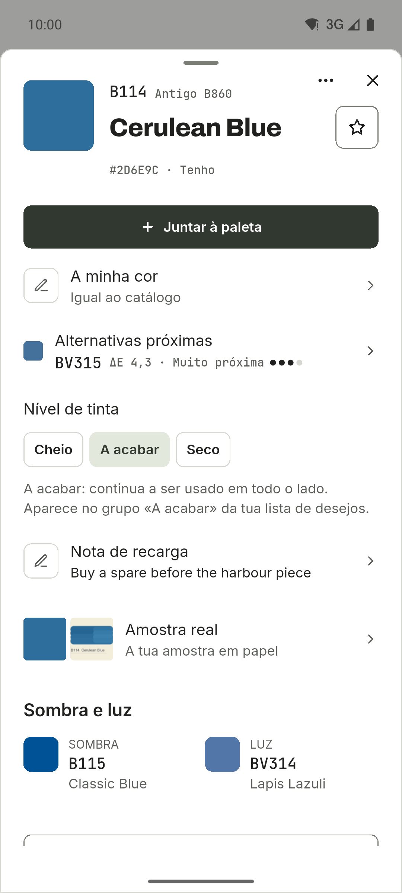
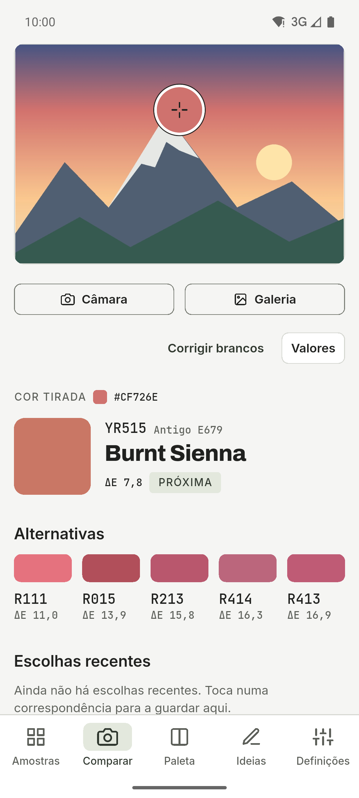
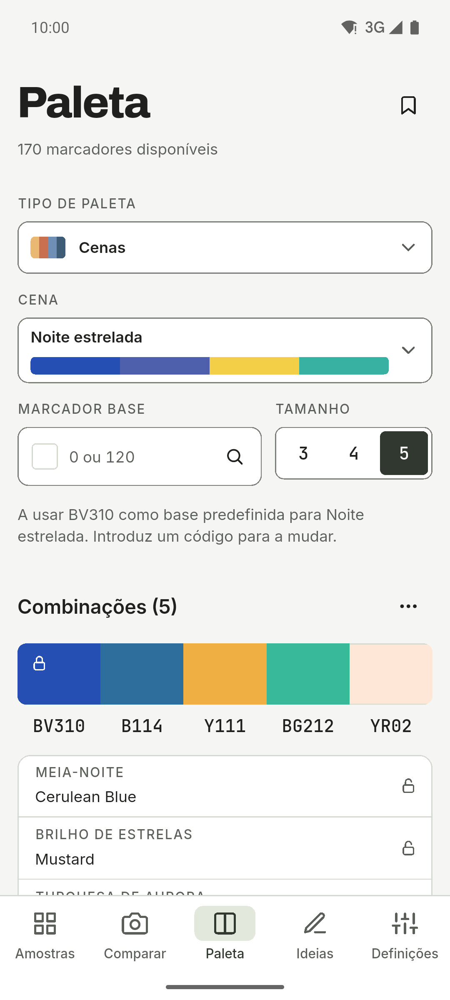
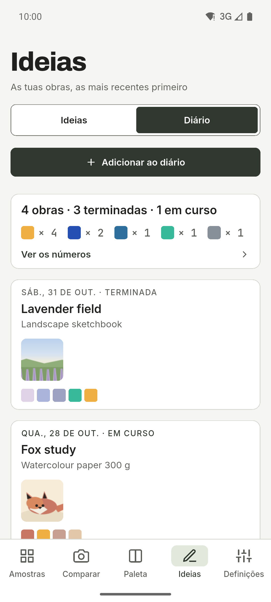
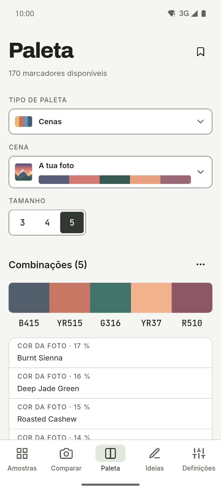
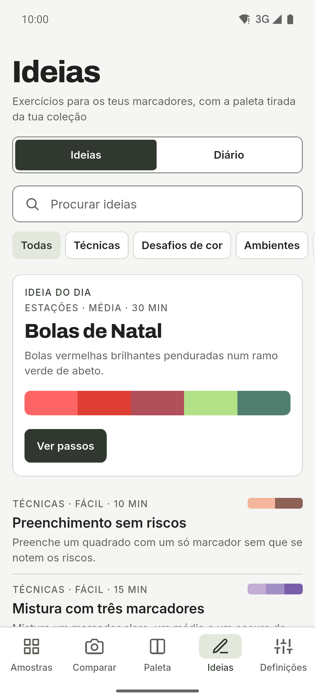
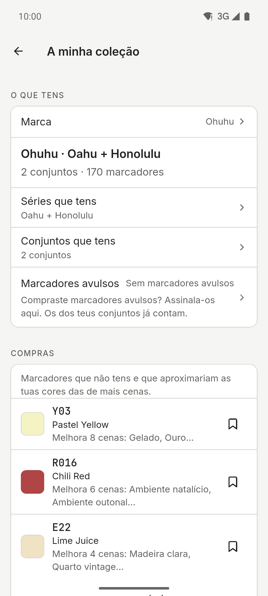
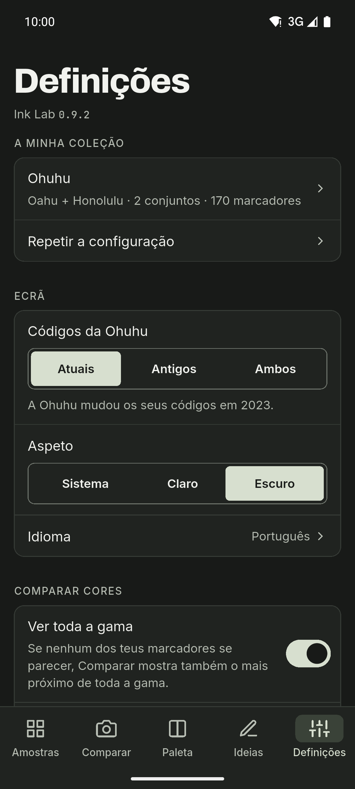

[English](README.md) · [Español](README.es.md) · [Deutsch](README.de.md) · [Français](README.fr.md) · **Português** · [Italiano](README.it.md)

  

# Ink Lab

Companheiro de amostras e paletas para quem desenha com marcadores de álcool.
Procura o código de uma cor, descobre que marcador da tua coleção se aproxima
mais de uma fotografia e cria paletas com teoria da cor usando apenas os
marcadores que tens. App para Android, com tema claro e escuro, barra lateral em
tablets e seis idiomas.

**Grátis · Sem anúncios · Sem conta · Offline · Código aberto**

A IA é opcional e está desligada por predefinição.

## Transferência

  
  
  

iPhone na App Store. Android no GitHub e em teste fechado no Google Play.

Entrar na beta do Google Play

1. Junta-te ao grupo [ink-lab-testers](https://groups.google.com/g/ink-lab-testers). Inicia sessão na Google e carrega em «Aderir ao grupo».
2. Aceita o teste: [play.google.com/apps/testing/es.inklab.app](https://play.google.com/apps/testing/es.inklab.app).
3. Instala a app a partir do Google Play. Atualiza-se sozinha.

Fica 14 dias: a Google exige 12 testadores durante 14 dias antes da publicação.
Comentários: inklab@mainshai.com.

Instalar o APK do GitHub

1. Transfere o APK e o `SHA256SUMS.txt` da [última
   versão](https://github.com/dferrandizmont/ink-lab/releases/latest). Verifica-a com
   `sha256sum -c SHA256SUMS.txt`.
2. Permite a instalação de origens desconhecidas quando o telemóvel o pedir e
   abre o APK.

## Capturas de ecrã

  
  
  
  
  

Mais capturas de ecrã

  
  
  
  

Toca numa captura para a ampliar.

## Funcionalidades

- **Diário de desenhos.** Um registo do que pintas, com as suas fotos, os
  marcadores que usaste e os números por trás.
- **Quatro marcas.** Ohuhu (503 cores), DecoTime (313), Copic (358) e Finecolour
  (480), com o marcador mais próximo de cada outra marca em «Noutras marcas».
- **Comparar.** Toca num ponto de uma fotografia para encontrar o marcador da tua
  coleção mais próximo, e corrige os brancos.
- **Paletas e cenas.** Harmonias de teoria da cor, cadeias de mistura e 67 cenas
  prontas em 11 categorias.
- **Cópia de segurança.** Guarda tudo num ficheiro `.zip`, com as fotos do
  diário lá dentro.
- **Compras.** Uma lista de desejos, os marcadores secos e o que comprar a
  seguir.

Mais funcionalidades

- **Visão das cores.** Pré-visualiza uma paleta como a vê alguém com protanopia,
  deuteranopia, tritanopia ou acromatopsia.
- **Carta de amostras para imprimir.** Páginas A4 com uma caixa etiquetada para
  cada marcador que tens.
- **Ideias.** Exercícios e técnicas com as suas próprias paletas, e as tuas
  favoritas.
- **Amostras e a tua própria cor.** Códigos, nomes e valores hex, mais a cor que
  o teu marcador dá mesmo.
- **Partilhar.** Envia uma paleta, uma carta ou uma entrada do diário a outra
  app como imagem.
- **IA, se quiseres.** Sugestões de paletas opcionais: Gemini Nano no telemóvel ou
  OpenRouter com a tua própria chave.
- **Widget «Ideia do dia».** Um widget de Android para o ecrã principal com o
  exercício de hoje, nas cores dos teus marcadores. Muda sozinho todos os dias e
  um toque abre a ideia.

## Privacidade

Os teus dados ficam no telemóvel: sem conta, servidor nosso, análise, anúncios ou
rastreio; sem IA, a rede nunca é usada. O ML Kit da IA no dispositivo envia à
Google diagnósticos de utilização, nunca pedidos, cores ou fotos. O acesso à
câmara e à galeria só serve para comparar cores, criar cenas, definir a tua
própria cor e juntar fotos ao diário; essas fotos são processadas no dispositivo,
e as do diário ficam na pasta privada da app e nunca são enviadas. Quando
partilhas uma paleta, uma carta ou a cópia `.zip`, o ficheiro só vai para a app
que escolheres, e mais nada.

[Site](https://inklab.mainshai.com/pt/) · [Política de privacidade](https://inklab.mainshai.com/pt/privacy/) ·
[Detalhe técnico](docs/privacy.en.md) · Apoio: **inklab@mainshai.com**.

## Novidades

A versão 0.10.0 já cá está. Novidade: um widget de Android para o ecrã principal
com a ideia do dia, nas cores dos teus marcadores. A série 0.9 arrumou a app. A
lista completa está em [CHANGELOG.md](CHANGELOG.md) e nas
[versões](https://github.com/dferrandizmont/ink-lab/releases).

## Contribuir

Erros, ideias e traduções são bem-vindos. Como compilar, testar e contribuir:
[CONTRIBUTING.md](CONTRIBUTING.md).

## Licença

Código sob [MIT](LICENSE), Copyright (c) 2026 Daniel Mont Ferrandiz. Documentação e
textos próprios: [CC BY-SA 4.0](LICENSE-CONTENT.md). Os dados dos catálogos são
referências factuais de terceiros e ficam fora de ambas as licenças; os tipos de
letra (SIL OFL 1.1) e outros materiais de terceiros mantêm as suas condições.

Um projeto independente: **sem qualquer relação com a Ohuhu, a DecoTime, a Copic ou a Finecolour, sem patrocínio nem apoio**. «Ohuhu», «Oahu», «DecoTime», «Copic» e «Finecolour» são marcas dos seus proprietários.
Avisos completos: [NOTICE.md](NOTICE.md).

Para comunicar uma vulnerabilidade: [SECURITY.md](SECURITY.md).
