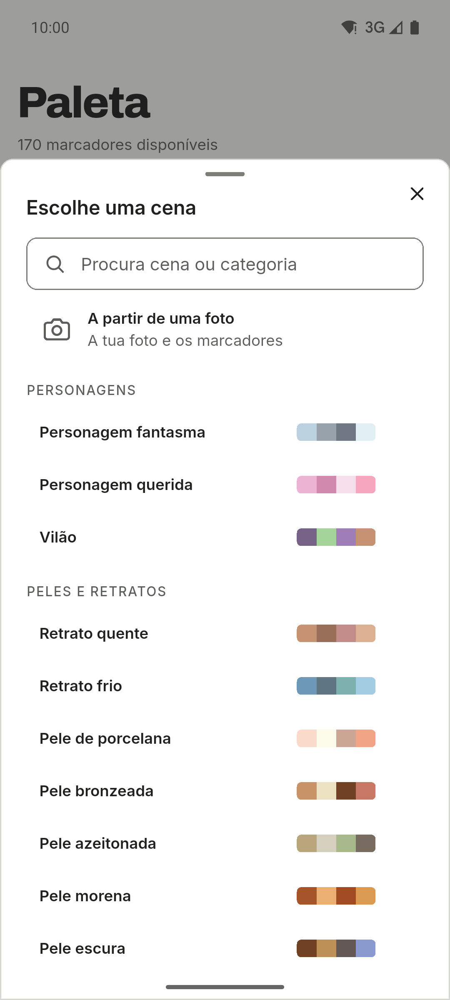
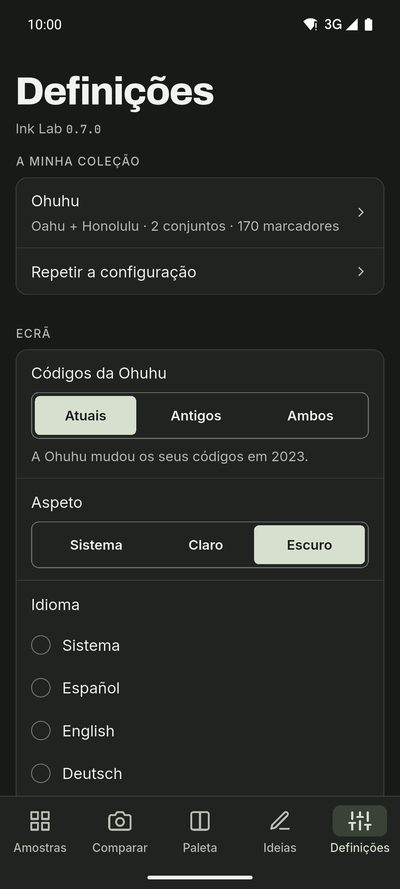

[English](README.md) · [Español](README.es.md) · [Deutsch](README.de.md) · [Français](README.fr.md) · **Português** · [Italiano](README.it.md)

  

# Ink Lab

Companheiro de amostras e paletas para quem desenha com marcadores de álcool.
Procura o código de uma cor, descobre que marcador da tua coleção se aproxima
mais de uma fotografia e cria paletas com teoria da cor usando apenas os
marcadores que tens. App para Android, com tema claro e escuro, barra lateral em
tablets e seis idiomas.

**Grátis · Sem anúncios · Sem conta · Offline · Código aberto**

A IA é opcional e está desligada por predefinição.

## Transferência

  
  
  <!--
  
  -->

Android no GitHub e em teste fechado no Google Play. O iOS chegará mais tarde.

Entrar na beta do Google Play

Qualquer pessoa pode entrar no teste fechado:

1. Junta-te ao grupo [ink-lab-testers](https://groups.google.com/g/ink-lab-testers). Inicia sessão na Google e carrega em «Aderir ao grupo».
2. Aceita o teste: [play.google.com/apps/testing/es.inklab.app](https://play.google.com/apps/testing/es.inklab.app).
3. Instala a app a partir do Google Play. Atualiza-se sozinha.

Fica 14 dias: a Google exige 12 testadores durante 14 dias antes da publicação.
Comentários: inklab@mainshai.com.

Instalar o APK do GitHub

1. Transfere o APK e o `SHA256SUMS.txt` da [última
   versão](https://github.com/dferrandizmont/ink-lab/releases/latest). Verifica-a com
   `sha256sum -c SHA256SUMS.txt`.
2. Permite a instalação de origens desconhecidas quando o telemóvel o pedir e
   abre o APK.

## Capturas de ecrã

  
  
  
  
  

Mais capturas de ecrã

  
  
  

Toca numa captura para a ampliar.

## Funcionalidades

- **Os meus marcadores.** Um guia inicial monta a coleção de cada marca a partir
  das tuas séries, conjuntos e marcadores avulsos.
- **Comparar com uma fotografia.** Toca num ponto para encontrar o teu marcador
  mais próximo; corrige os brancos para que as cores recolhidas sejam fiéis.
- **A tua própria cor.** A cor do catálogo é uma aproximação; define a cor que o
  teu marcador dá mesmo, pelo hex ou por uma fotografia.
- **Paletas e cadeias de mistura.** Harmonias baseadas na teoria da cor e
  cadeias de mistura de três a cinco marcadores, do mais claro ao mais escuro.
- **Cenas.** 67 receitas em 11 categorias, cada uma com os seus papéis de cor.
- **Diário de desenhos.** Um registo do que pintas: data, papel, marcadores,
  notas e até quatro fotos.
- **Quatro marcas.** Ohuhu (503 cores), DecoTime (313), Copic (358) e Finecolour (480), com seleção
  individual de marcadores.

Mais funcionalidades

- **Amostras.** Códigos, nomes e valores hex, com pesquisa, filtros e favoritos.
- **Cena a partir de uma fotografia.** Converte as cores principais de uma
  fotografia nos teus marcadores mais próximos.
- **Partilhar e imprimir.** Partilha uma paleta como imagem ou cria uma carta de
  amostras A4 para imprimir.
- **Lista de desejos e secos.** Guarda os marcadores que queres comprar e marca
  os gastos como secos para a app os omitir.
- **Ideias e IA.** Desafios e técnicas, mais o Gemini Nano opcional em
  dispositivos Android compatíveis ou o OpenRouter com a tua própria chave de API.
- **Cópia de segurança.** Exporta e importa os teus dados como texto JSON, sem fotos.

## Privacidade

Os teus dados ficam no telemóvel: sem conta, servidor nosso, análise de utilização
própria, anúncios ou rastreio; sem IA, a rede nunca é usada. O ML Kit da IA no
dispositivo envia à Google diagnósticos de utilização, nunca pedidos, cores ou
fotos. O acesso à câmara e à galeria só serve para comparar cores, criar cenas,
definir a tua própria cor e juntar fotos ao diário; as fotos de comparação e de
cenas são processadas no dispositivo, e as do diário ficam na pasta privada da app
e nunca são enviadas. Quando partilhas uma paleta ou uma carta, a imagem só vai
para a app que escolheres.

[Site](https://inklab.mainshai.com/pt/) · [Política de privacidade](https://inklab.mainshai.com/pt/privacy/) ·
[Detalhe técnico](docs/privacy.en.md) · Apoio: **inklab@mainshai.com**.

## Novidades

A 0.7.0 traz o diário de desenhos, as cadeias de mistura, as tuas próprias cores
com a correção de brancos, a lista de desejos, os marcadores secos, as cartas
para imprimir e a partilha. A lista completa está em [CHANGELOG.md](CHANGELOG.md).

## Contribuir

Erros, ideias e traduções são bem-vindos. Como compilar, testar e contribuir:
[CONTRIBUTING.md](CONTRIBUTING.md).

## Licença

Código sob [MIT](LICENSE), Copyright (c) 2026 Daniel Mont Ferrandiz. Documentação
e textos próprios: [CC BY-SA 4.0](LICENSE-CONTENT.md). Os dados dos catálogos são
referências factuais de terceiros e ficam fora de ambas as licenças; os tipos de
letra (SIL OFL 1.1) e outros materiais de terceiros mantêm as suas condições,
listadas em [NOTICE.md](NOTICE.md).

Um projeto independente: **sem qualquer relação com a Ohuhu, a DecoTime, a Copic ou a Finecolour, sem patrocínio nem apoio**. «Ohuhu», «Oahu», «DecoTime», «Copic» e «Finecolour» são marcas dos seus proprietários.
As fontes e os avisos completos estão em [NOTICE.md](NOTICE.md).

Para comunicar uma vulnerabilidade: [SECURITY.md](SECURITY.md).
